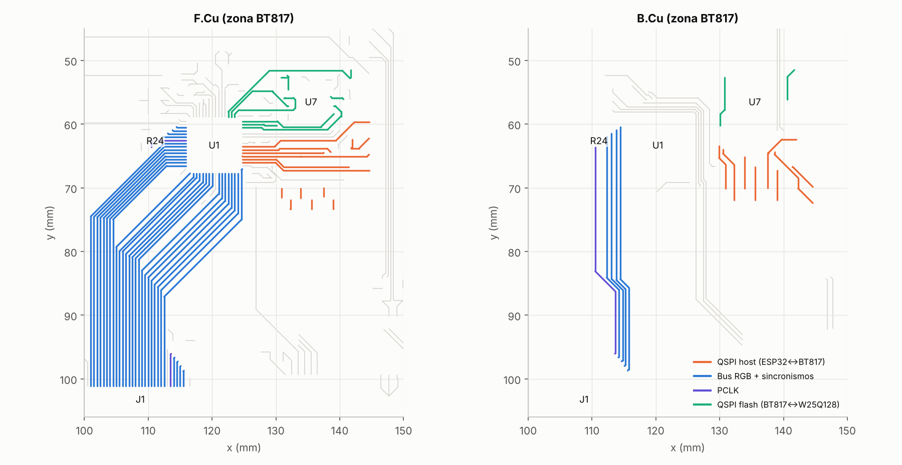
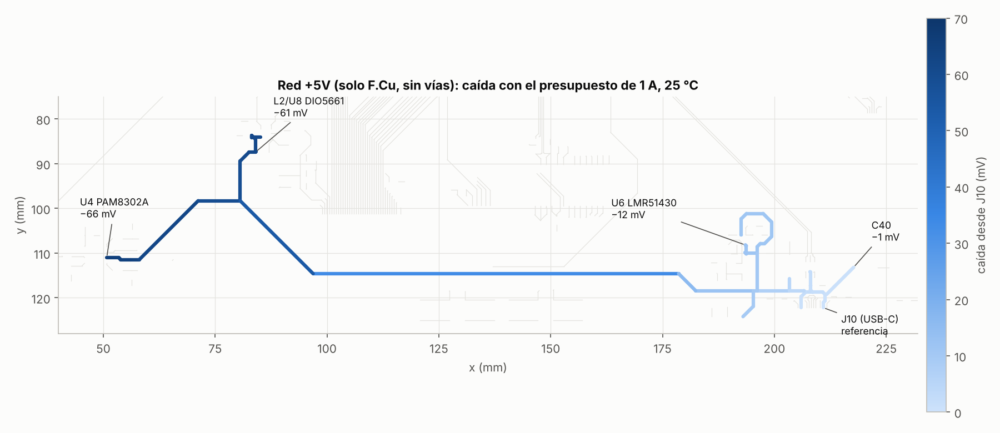
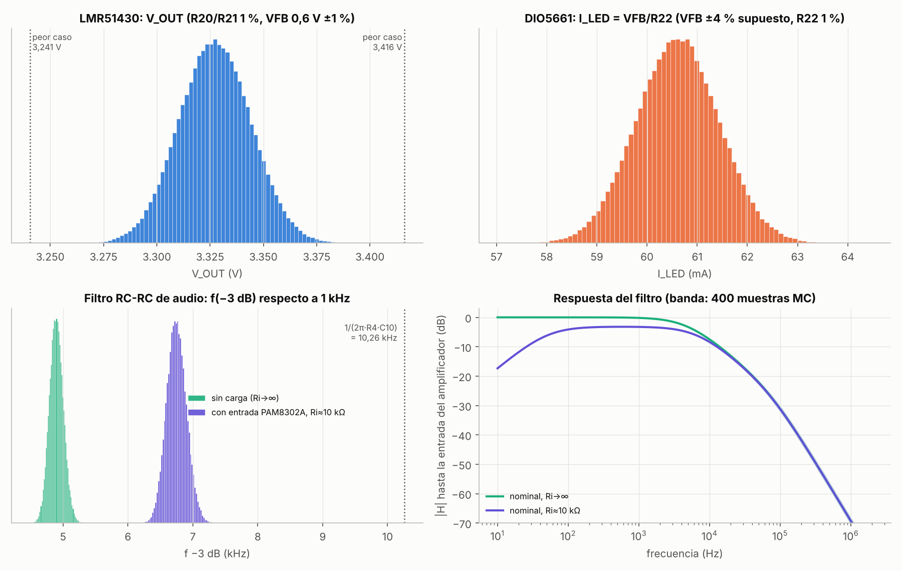
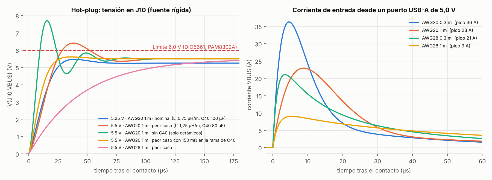
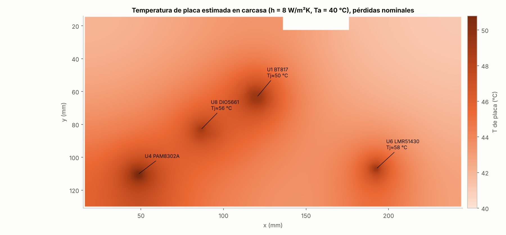

# Análisis técnico de la placa principal OCX

| | |
|---|---|
| Diseño analizado | `hardware/ocxPrototype.kicad_pcb` y esquemas, commit `b7c4baa` («Fab v1.1») |
| Alcance | Solo análisis. No se ha modificado nada en `hardware/`. |
| Apilado usado | JLC04161H-2116: preimpregnado 0,1164 mm, εr 4,16; núcleo 1,265 mm; Cu exterior 35 µm; Cu interior 15,2 µm (0,5 oz); máscara 15 µm, εr 3,8 |
| Herramientas | atlc 4.6.1 (solver 2D por diferencias finitas), solver 2D propio de volúmenes finitos (Python/SciPy), ngspice 42, Python 3.13 (NumPy 2.5, SciPy 1.18, Matplotlib 3.11) |
| Reproducción | `analisis-tecnico/scripts/ejecutar_todo.sh` (ver §8) |

Toda la geometría (pistas, vías, pads, rellenos de In1/In2) se ha leído directamente del `.kicad_pcb`. Los valores que dependen de hojas de datos que no se han podido consultar en esta sesión están marcados como **no verificados** y se resumen en §7.

---

## Resumen

**Integridad de señal: sin problemas.**
- El par USB tiene **Zdiff = 89,6–89,9 Ω**, dentro de los 90 Ω ±15 % de USB. Con las tolerancias de fabricación queda entre 81,5 y 99,6 Ω.
- Las pistas QSPI de 0,2 mm tienen **48,7 Ω**.
- **QSPI y el bus RGB no corren en paralelo en ningún punto.** Solo se acercan a 0,80 mm (borde a borde) en el abanico de pines del BT817, y la diafonía resultante es < 0,3 mV.
- La peor diafonía de toda la placa está dentro de un mismo bus: SCK→MISO, con 28,6 mV, menos del 1 % de 3,3 V.

**Alimentación: el cobre de la placa no es el problema; el cable sí.**
- Con 1 A, las caídas en la placa son pequeñas:
  - J10→PAM8302A: 66 mV.
  - J10→DIO5661: 61 mV.
  - J10→LMR51430: 12 mV.
  - Plano de +3,3 V: ≤ 3,4 mV.
  - Retorno por GND: ≤ 4 mV.
- Con un cable de **1 m AWG28**, la entrada del LMR51430 baja a **4,27–4,54 V**. Eso queda por debajo de su mínimo de 4,5 V.

**Tolerancias: todas en margen.**
- 3,3 V del buck: **3,277–3,379 V** (±3σ) y 3,241–3,416 V en el peor caso por extremos.
- Retroiluminado: **60,6 mA ±4 %**, sujeto a la tolerancia de VFB, que está sin verificar.

**Filtro de audio: el corte real no es el que sugiere R4·C10.**
- R4·C10 da 10,3 kHz, pero las dos etapas se cargan entre sí y el corte real es **≈ 4,9 kHz** sin carga.
- Con la entrada del PAM8302A (Ri ≈ 10 kΩ) sube a ≈ **6,7 kHz**, con −3,3 dB de pérdida en banda.

**Hot-plug USB: sin margen frente a 6,0 V en las combinaciones desfavorables.**
- Con parámetros típicos, el pico es de 5,44–5,73 V.
- Con un cable AWG20 y una L′ del cable ≥ 1 µH/m, un C40 al −20 % y una fuente de 5,5 V, el pico supera **6,0 V** (6,13–6,59 V).
- El TVS D1 (P6SMB6.8CA) no conduce por debajo de ~6,45 V, así que **no protege** el límite de 6,0 V.
- **La corriente de entrada desde un puerto USB-A es de 8–41 A de pico** (≈ 0,6 mC), unas **12 veces** el límite de 10 µF de USB 2.0. Además, el VBUS del host cae hasta 3,0 V.

**Temperaturas: amplio margen.** Tj ≤ 67 °C incluso en carcasa a 40 °C con las pérdidas más pesimistas.

### Tabla de resultados

Leyenda: ✔ cumple con margen · ⚠ margen justo o depende de una hipótesis · ✘ no cumple

| # | Aspecto | Resultado | Límite / objetivo | Margen | Veredicto |
|---|---|---|---|---|---|
| 1.1 | Zdiff par USB 0,2/0,25 mm (F.Cu, con máscara) | 89,9 Ω (atlc) · 89,6 Ω (solver propio) | 90 Ω ±15 % (76,5–103,5 Ω) | −0,2 % del nominal | ✔ |
| 1.2 | Zdiff USB con tolerancias de fabricación (Monte Carlo, 300 muestras) | 81,5–99,6 Ω (percentiles 1–99 %) | 76,5–103,5 Ω | ≥ 3,9 Ω | ✔ |
| 1.3 | Z0 de pista QSPI de 0,2 mm (F.Cu y B.Cu) | 48,7 Ω (fabricación: 44,3–54,2 Ω) | ~50 Ω (sin requisito estricto) | — | ✔ |
| 1.4 | Diafonía QSPI ↔ RGB | sin tramos paralelos; separación mínima 0,80 mm; < 0,3 mV | margen de ruido ≈ 0,8 V | > 2500× | ✔ |
| 1.5 | Peor diafonía dentro de un bus (SCK→MISO, flanco de 1 ns) | 28,6 mV | ≈ 0,8 V | 28× | ✔ |
| 1.6 | Sobreimpulso de SCK QSPI (35–60 mm, flanco de 1 ns) | 1,7–4,3 % (driver 40 Ω) · 9–19 % (driver 25 Ω) | — | — | ⚠ depende de la fuerza de salida del ESP32 |
| 2.1 | Caída +5V J10→DIO5661 / J10→PAM8302A (1 A, 25 °C) | 61 / 66 mV (+ 4 mV por GND) | — | — | ✔ |
| 2.2 | Ídem en pico de audio (1,6 A, 60 °C) | 129 / 149 mV (+ 7–9 mV por GND) | — | — | ✔ |
| 2.3 | Caída en el plano de +3,3 V (0,51 A) | ≤ 3,4 mV (≤ 2,1 mV respecto al punto de realimentación) | ESP32-S3 ≥ 3,0 V | — | ✔ |
| 2.4 | VIN del LMR51430 con cable de 1 m AWG28 a 1 A | 4,27–4,54 V | 4,5 V mín. | −0,23 a +0,04 V | ✘ |
| 3.1 | V_OUT del LMR51430 | 3,277–3,379 V (±3σ) · 3,241–3,416 V (peor caso) | 3,0–3,6 V | ≥ 0,18 V | ✔ |
| 3.2 | I_LED del DIO5661 | 58,1–63,1 mA (±3σ, con VFB ±4 % supuesto) | If máx. del panel (por verificar) | — | ✔ / ⚠ |
| 3.3 | f(−3 dB) del filtro de audio | 4,6–5,2 kHz sin carga · 6,3–7,2 kHz con Ri ≈ 10 kΩ (±3σ) | 10,26 kHz que sugiere R4·C10 | −35 a −55 % | ⚠ distinto de lo previsto |
| 4.1 | Pico de hot-plug con fuente de 5,25 V y parámetros típicos | 5,44–5,47 V | 6,0 V | 0,53 V | ✔ |
| 4.2 | Pico de hot-plug en el peor caso (L′ ≤ 1 µH/m, C40 −20 %), fuente de 5,25 V / 5,5 V | 5,89 V / 6,17 V | 6,0 V | +0,11 V / −0,17 V | ⚠ / ✘ |
| 4.3 | Pico de hot-plug en caso extremo (L′ 1,25 µH/m, ESR de C40 15 mΩ) | 6,29 V (5,25 V) · 6,59 V (5,5 V) | 6,0 V | −0,29 / −0,59 V | ✘ |
| 4.4 | Corriente de entrada desde un puerto USB-A | 8,4–40,5 A de pico; 458–619 µC | USB 2.0: ≤ 10 µF (≈ 50 µC a 5 V) | ≈ 12× por encima | ✘ |
| 4.5 | Caída del VBUS del host al enchufar | hasta 3,0–4,7 V | ≤ 0,33 V en los puertos vecinos (USB 2.0) | — | ✘ |
| 5.1 | Tj del LMR51430 | 40 °C (placa al aire, 25 °C) · 58–67 °C (carcasa, 40 °C) | ~125 °C (por verificar) | ≥ 58 °C | ✔ |
| 5.2 | Tj del DIO5661 | 38 °C · 56–67 °C | ~125 °C (por verificar) | ≥ 58 °C | ✔ |
| 5.3 | Tj del BT817 | 33 °C · 50–55 °C | ~125 °C (por verificar) | ≥ 70 °C | ✔ |

### Hallazgos que no estaban en la pregunta

1. **El apilado guardado en el `.kicad_pcb` no es el JLC04161H-2116.** Usa preimpregnado de 0,1 mm con εr 4,5, núcleo de 1,24 mm y Cu interior de 35 µm. Con ese apilado, la calculadora de KiCad da **43,5 Ω** y **81,8 Ω de Zdiff**, frente a los 48,7 / 89,9 Ω reales. Si alguna anchura se dimensionó con él, se dimensionó contra valores falsos (§1.1).
2. **El presupuesto de 1 A supera lo que USB garantiza sin negociación.** USB 2.0 por defecto da 500 mA y USB-C «Default» lo mismo. La placa solo tiene Rd (R12 y R13 de 5,1 kΩ) y no lee CC, así que no sabe si la fuente admite 1,5 A o 3 A (§2.5).
3. **La ESR baja del polímero C40 (28 mΩ) amortigua mal el transitorio de enchufado.** El óptimo está en ≈ 150 mΩ en la rama de C40 (§4.4).
4. **El LMR51430 y el DIO5661 tienen una sola vía a GND**, a 3,8 y 2,5 mm de su pin de masa. Esto no impide cumplir en temperatura, pero empeora el camino térmico y el lazo de conmutación del buck (§5).

---

## 1. Integridad de señal

### 1.1 Apilado

| Parámetro | JLC04161H-2116 (usado) | Guardado en el `.kicad_pcb` |
|---|---|---|
| Preimpregnado F.Cu–In1 / In2–B.Cu | 0,1164 mm, εr 4,16 | 0,1 mm, εr 4,5 |
| Núcleo In1–In2 | 1,265 mm | 1,24 mm, εr 4,5 |
| Cu interior | 15,2 µm (0,5 oz, estándar de JLC) | 35 µm |
| Máscara | 15 µm, εr 3,8 (supuesto) | 10 µm, εr por defecto |

F.Cu tiene como referencia In1 (GND) y B.Cu tiene como referencia In2 (+3,3 V). El apilado es simétrico, así que una pista de igual anchura tiene la misma impedancia en ambas caras.

### 1.2 Impedancias (solver 2D)

Las secciones se resolvieron con **atlc** (mapas de bits generados por `si_atlc_bmp.py`, 40 px por espesor de dieléctrico) y con un **solver propio** de volúmenes finitos en malla no uniforme (`si_solver2d.py`). Ambos son cuasiestáticos y calculan C con y sin dieléctrico; de ahí se obtienen L, Z0 y εeff.

| Sección | atlc | Solver propio |
|---|---|---|
| Pista 0,2 mm, con máscara | Z0 48,7 Ω (εeff 3,22) | 48,6 Ω (3,21) |
| Pista 0,2 mm, sin máscara | 50,9 Ω | 50,6 Ω |
| Pista 0,2 mm, apilado del `.kicad_pcb` | 43,5 Ω | 43,6 Ω |
| **Par USB 0,2/0,25 mm, con máscara** | **Zdiff 89,9 Ω** · Zodd 44,9 · Zeven 52,2 · Zcomm 26,1 Ω | **89,6 Ω** · 44,8 · 52,2 · 26,1 Ω |
| Par USB 0,2/0,25 mm, sin máscara | 94,4 Ω | 93,6 Ω |
| Par USB 0,2/0,30 mm (4,9 mm del recorrido) | 91,6 Ω | 91,3 Ω |
| Par USB, apilado del `.kicad_pcb` | 81,8 Ω | 81,7 Ω |

- **Convergencia**: con atlc a 20, 30, 40 y 60 px por h sale 91,0 / 89,7 / 89,9 / 89,5 Ω. El solver propio converge a 89,6 Ω, y su resultado no cambia al doblar la caja. Ambos coinciden a menos del 0,5 %.
- **Monte Carlo de fabricación** (300 muestras con el solver propio): h ±10 %, εr 4,16 ±0,15, anchura ±0,02 mm (paso entre ejes fijo), Cu 30–45 µm, máscara 10–25 µm. Resultado: **Zdiff = 90,1 Ω de media, 81,5–99,6 Ω (percentiles 1–99 %)**, y Z0 de 0,2 mm = 44,3–54,2 Ω.

### 1.3 Par USB (Full-Speed)

- **Recorrido**: J10 → U2 (USBLC6-2) → R14/R15 (22 Ω) → J3 pines 3/4 (GPIO19/20 del ESP32-S3).
- **Longitudes**: D+ 72,4 mm, D− 71,7 mm (de ellos, 3,4 mm tras las resistencias). **Desfase de longitud: 0,71 mm (≈ 4 ps).**
- **Acoplamiento**: 46,3 mm a 0,25 mm de separación, 4,9 mm a 0,30 mm y 4,6 mm a 0,625 mm junto al conector y la protección.
- **Vías y cambio de cara**: tiene 5 vías y 10,4 mm en B.Cu (puentes entre las filas A/B del conector USB-C), donde la referencia pasa a ser el plano de +3,3 V.
- **Longitud eléctrica**: el par mide unos 0,42 ns. Los flancos de Full-Speed son de 4–20 ns, así que el par es eléctricamente corto (Td < t_r/6). A 12 Mb/s la impedancia no es crítica, aunque aun así cumple 90 Ω ±15 %.
- **Nota de uso**: el puerto USB propio del DevKitC-1 va en paralelo con las mismas líneas GPIO19/20, lo que añade un *stub* despreciable en FS. No deben usarse ambos puertos a la vez.

### 1.4 Pistas QSPI

**Host (ESP32↔BT817):**
- Longitudes en placa: SCK 26,4 mm, MOSI 26,5, MISO 28,2, CS 30,0, IO2 34,9 e IO3 30,0 mm. Hay que sumar el trazado interno del DevKit, que no se conoce.
- Tiempo de vuelo: 0,16–0,21 ns (≈ 6 ps/mm), despreciable frente a un periodo de 33 ns a 30 MHz.
- Los pines usados son GPIO9–14. Según el mapa IO_MUX del ESP32-S3 (no verificado en esta sesión), son los pines FSPI directos, así que no hay retardo de GPIO matrix.

**Flash (BT817↔W25Q128):** recorridos de 13–33 mm.

**Integridad del propio SCK** (simulación exacta de línea + IFFT, receptor de 5 pF):

| Longitud total | Driver 40 Ω, t_r 1 ns | Driver 40 Ω, 2 ns | Driver 25 Ω, 1 ns | Driver 25 Ω, 2 ns |
|---|---|---|---|---|
| 35 mm (solo placa) | 1,7 % | 0,8 % | 9,3 % | 4,4 % |
| 60 mm (placa + DevKit estimado) | 4,3 % | 2,0 % | 18,8 % | 6,7 % |

Con la fuerza de salida máxima del ESP32 y flancos de ~1 ns, el sobreimpulso puede superar VDD + 0,3 V (lo absorben los diodos de protección de entrada). Ver la recomendación R7.

### 1.5 Diafonía QSPI ↔ RGB

**Búsqueda geométrica** (`si_geometria.py`): se buscaron todos los pares de segmentos en la misma capa, paralelos dentro de ±8° y con menos de 3 mm entre ejes.
- **No hay ningún tramo QSPI (host) paralelo a una línea del bus RGB.** El QSPI sale del BT817 hacia la derecha (hacia J2) y el RGB hacia la izquierda y abajo (hacia J1) (fig. 1).
- El acercamiento mínimo es **SCK–B7 = 0,80 mm** borde a borde, en el abanico de pines de U1 (pines 1 y 3), con trazados divergentes.
- La flash (SPIM) queda a ≥ 6,3 mm del RGB.
- Entre F.Cu y B.Cu no hay acoplamiento: los planos In1/In2 los apantallan.
- Bajo USB, QSPI y RGB **no hay cortes de plano**. Los únicos huecos son los antipads (≤ 1,7 mm continuos) donde las pistas terminan en vías, pines THT de J2/J3 o puntos de prueba.



*Figura 1. QSPI host (naranja) y bus RGB (azul) salen por lados opuestos de U1; el PCLK (violeta) baja por B.Cu junto a DISP.*

**Cálculo**:
- Se obtuvieron las matrices L y C por unidad de longitud con el solver 2D para cada separación real.
- Se resolvió de forma exacta la línea acoplada de 2 conductores en frecuencia (matriz de cadena 4×4 = exp(M·l)) con terminaciones realistas: driver de 40 Ω + 2 pF y receptor de 5 pF. Después se aplicó la IFFT con flancos de 1 y 2 ns (10–90 %).
- **Validación**: en SCK→MISO con las mismas terminaciones, este método da 22,59 / 24,78 mV y el modelo CPL de ngspice 22,62 / 24,77 mV.

| Caso (agresor → víctima) | Separación | Tramo paralelo | kL / kC | Pico en la víctima, t_r 1 ns | t_r 2 ns |
|---|---|---|---|---|---|
| **SCK→B7: QSPI–RGB, cota superior** (supuesto paralelo 1 mm) | 0,80 mm | 1,0 mm | 0,020 / 0,005 | **0,26 mV** | 0,14 mV |
| SCK→MISO (QSPI host, F.Cu) | 0,224 mm | 16,6 mm | 0,122 / 0,056 | 28,6 mV | 14,6 mV |
| SPIM_SCLK→SPIM_MOSI (flash) | 0,238 mm | 9,0 mm | 0,114 / 0,051 | 15,1 mV | 7,7 mV |
| PCLK→DISP (B.Cu) | 0,31 mm | 12,2 mm | 0,084 / 0,032 | 14,0 mV | 7,1 mV |
| PCLK→DISP (F.Cu, junto a J1) | 0,30 mm | 4,4 mm | 0,087 / 0,034 | 5,6 mV | 2,8 mV |
| PCLK(U1)→R0 (F.Cu) | 0,30 mm | 3,4 mm | 0,087 / 0,034 | 4,4 mV | 2,3 mV |
| PCLK→HSYNC (B.Cu) | 0,77 mm | 1,9 mm | 0,021 / 0,005 | 0,53 mV | 0,27 mV |

El pico mostrado es el mayor entre receptor en el extremo cercano y en el lejano. El margen de ruido CMOS a 3,3 V es ≈ 0,8 V (0,25·VDD).

**Conclusión de diafonía**:
- Entre QSPI y RGB es despreciable (< 0,3 mV, −80 dB).
- El PCLK de 24 MHz solo tiene vecinos cercanos dentro de su propio bus: DISP (estática) y R0/HSYNC, con ≤ 14 mV.
- El mayor acoplamiento es interno al QSPI (SCK→MISO, 28,6 mV), 28 veces por debajo del margen de ruido.

---

## 2. Alimentación (caídas DC)

### 2.1 Presupuesto de corriente en el peor caso (≈ 1 A en +5V)

| Carga | Hipótesis | I en +5V |
|---|---|---|
| Retroiluminado al 100 % (U8, por L2) | I_LED = 0,2 V / 3,3 Ω = 60,6 mA a ~21,2 V → 1,28 W; η ≈ 85 % | 0,31 A |
| Buck LMR51430 (U6) | 0,51 A en 3,3 V (ESP32-S3 en TX WiFi 0,35 A, BT817 0,06, lógica LCD 0,06, flash 0,02, táctil 0,01, LED D2 0,012); η ≈ 90 % | 0,375 A |
| Audio PAM8302A (U4) | resto hasta ~1 A (≈ 1,3 W medios); picos de 0,92 A con 4 Ω a plena potencia | 0,32 A (0,92 A de pico) |
| **Total** | | **≈ 1,0 A** (1,6 A en picos de audio) |

### 2.2 Red de +5V

La red de +5V va **toda en pistas de F.Cu de 0,5 y 0,8 mm, sin vías ni rellenos**, con unos 259 mm de cobre. Se modeló como una red resistiva 1D a partir de los segmentos reales, con uniones en T y pads resueltos; ρ(Cu) = 1,72 µΩ·cm a 20 °C (+0,393 %/°C) y 35 µm de espesor. Las dos parejas de pines VBUS de J10 se tomaron como fuente.

| Punto | R desde J10 | Caída con 1 A (25 °C) | 1 A (60 °C) | Pico de audio 1,6 A (25 °C) | 1,6 A (60 °C) |
|---|---|---|---|---|---|
| U6 VIN (buck) | 17,3 mΩ | 12,4 mV | 14,1 mV | 18,1 mV | 20,5 mV |
| C40 | 7,9 mΩ | 1,1 mV | 1,2 mV | 1,7 mV | 1,9 mV |
| L2 / U8 VIN (DIO5661) | 95,8 / 100,9 mΩ | 61,3 mV | 69,6 mV | 113,5 mV | 128,8 mV |
| U4 VDD (PAM8302A) | 109,0 mΩ | 65,6 mV | 74,4 mV | 131,0 mV | 148,7 mV |



*Figura 2. Caída de tensión a lo largo de la red de +5V con el presupuesto de 1 A. El tronco de 0,8 mm × ~123 mm (x = 80→195 mm) concentra casi toda la caída.*

**Retorno por GND (In1).** Se resolvió con una malla 2D de 0,2 mm sobre el relleno real de In1 (15,2 µm), más las pistas GND, las vías (barril de 20 µm) y los pads THT con radios de alivio. Las cargas de 3,3 V devuelven su corriente al buck y las de +5V a J10. Respecto a los pines GND de J10, el GND local queda en:
- **≤ 4,1 mV** con 1 A.
- **≤ 7,8 mV** en pico de audio.
- **≤ 8,8 mV** en pico de audio a 60 °C.

El peor punto es el PAM8302A.

### 2.3 Plano de +3,3 V (In2)

Malla 2D de 0,2 mm sobre el relleno real de In2, con pistas, vías y pads; 0,51 A repartidos por las cargas de §2.1.

| Carga | Caída desde L3 | Desde el punto de realimentación (R20) |
|---|---|---|
| ESP32 (J2 pines 1–2) | 3,2–3,4 mV | 1,8–2,1 mV |
| BT817 (pines VCC) | 2,0–2,2 mV | 0,6–0,8 mV |
| Flash, LCD (FB3), táctil | 1,9–2,1 mV | 0,5–0,7 mV |

La malla de 0,1 mm da el mismo resultado (±1 %). A 60 °C la caída máxima es de 3,9 mV, y con Cu interior de 1 oz baja a 2,3 mV. **La caída en el plano de +3,3 V es despreciable.**

### 2.4 Cable + placa: tensión en las cargas con 1 A

Lazo VBUS+GND del cable: AWG20 = 33,3 mΩ/m y AWG28 = 212,9 mΩ/m por conductor. Contactos: 20 mΩ (C-C) o 40 mΩ (A-C) en total. Se suman la red de +5V y el retorno por GND de la placa.

| Fuente | Cable | R lazo | V(J10) | VIN LMR51430 | VIN DIO5661 | VDD PAM8302A | V(J10) en pico de 1,6 A |
|---|---|---|---|---|---|---|---|
| 5,00 V | AWG20 0,3 m C-C | 40 mΩ | 4,96 V | 4,95 | 4,89 | 4,89 | 4,94 |
| 5,00 V | AWG20 1 m A-C | 107 mΩ | 4,89 V | 4,88 | 4,83 | 4,82 | 4,83 |
| 5,00 V | AWG28 0,3 m A-C | 168 mΩ | 4,83 V | 4,82 | 4,77 | 4,76 | 4,73 |
| 5,00 V | **AWG28 1 m A-C** | 466 mΩ | 4,53 V | **4,52** | 4,47 | 4,46 | **4,25** |
| 4,75 V | AWG20 1 m A-C | 107 mΩ | 4,64 V | 4,63 | 4,58 | 4,57 | 4,58 |
| 4,75 V | **AWG28 1 m C-C** | 446 mΩ | 4,30 V | **4,29** | 4,24 | 4,23 | **4,03** |

La tabla completa (16 combinaciones) está en `resultados/pdn_5v.json`. El DIO5661 (2,7–5,5 V según la descripción del símbolo en el esquema) y el PAM8302A siguen dentro de rango. **El LMR51430 («4.5-V to 36-V» en la descripción de su símbolo) queda por debajo de 4,5 V con 1 m de AWG28**, y en los picos de audio el VBUS de la placa llega a 4,0–4,25 V. Para 3,327 V de salida, el buck necesita ≈ 3,9–4,0 V (ciclo útil ~0,85 a 1,1 MHz, estimado), así que probablemente seguirá regulando, pero fuera de especificación y cerca de su UVLO (valor no verificado).

### 2.5 Compatibilidad con la fuente USB

Con R12 y R13 (Rd de 5,1 kΩ) la placa es un sumidero USB-C, pero no lee el Rp de la fuente. Sin negociación, USB 2.0 y USB-C «Default» solo garantizan **500 mA** (900 mA en USB 3.x), y el peor caso de la placa es ~1 A con picos de 1,6 A. Con cables A-C o puertos de PC, el limitador del puerto puede saltar o el VBUS puede hundirse. Ver la recomendación R3.

---

## 3. Tolerancias (Monte Carlo)

200 000 muestras (100 000 para el filtro). Los límites de tolerancia se tratan como ±3σ gaussianos y también como distribución uniforme (peor). Se dan los percentiles 0,135 % y 99,865 % (equivalentes a ±3σ).



*Figura 3. Histogramas de V_OUT, I_LED y f(−3 dB) del filtro, y respuesta del filtro con su banda Monte Carlo.*

### 3.1 Salida del LMR51430: V_OUT = VFB·(1 + R20/R21)

| | Valor |
|---|---|
| Nominal | 0,6 × (1 + 100/22) = **3,327 V** |
| Gauss (±3σ) | 3,277–3,379 V (σ = 17 mV) |
| Uniforme (±3σ) | 3,252–3,404 V |
| Peor caso por extremos | **3,241–3,416 V** |

Todo queda dentro de los rangos de alimentación del ESP32-S3 (3,0–3,6 V) y del W25Q128JV (2,7–3,6 V, según la descripción del símbolo). El margen mínimo es de 0,18 V hasta 3,6 V. No incluye el rizado ni los transitorios de carga.

### 3.2 Retroiluminado: I_LED = VFB/R22

La tolerancia de VFB del DIO5661 **no se ha podido verificar**. Se da de forma paramétrica:

| Tolerancia de VFB | ±3σ (gauss) | Peor caso |
|---|---|---|
| ±2 % | 59,3–62,0 mA | 58,8–62,4 mA |
| **±4 % (supuesto)** | **58,1–63,1 mA** | 57,6–63,7 mA |
| ±5 % | 57,5–63,7 mA | 57,0–64,3 mA |

El valor nominal es 60,6 mA. La resistencia R22 al 1 % aporta poco: la dispersión la domina VFB. Hay que comprobarlo contra el If máximo del retroiluminado del NHD-5.0-800480AF.

### 3.3 Filtro de audio RC-RC (AUDIO_L → R4/C10 → R3/C29 → C12 → PAM8302A)

**Las etapas no son independientes.**
- Por separado darían 10,26 kHz (R4·C10) y 33,9 kHz (R3·C29).
- Con condensadores iguales y R3 < R4, la segunda etapa carga a la primera. Los polos reales, sin carga, son **4,74 kHz y 73,2 kHz**.
- La entrada del PAM8302A (Ri, a tierra virtual a través de C12 de 0,22 µF) forma además un divisor con R4 + R3 y desplaza el corte relativo.

Ri ≈ 10 kΩ es un valor no verificado; por eso se da en función de Ri:

| Ri del PAM8302A | f(−3 dB) nominal | ±3σ (MC) | Peor caso | Pérdida en banda |
|---|---|---|---|---|
| ∞ (sin carga) | 4,89 kHz | 4,59–5,24 kHz | 4,45–5,44 kHz | −0,2 dB |
| 20 kΩ | 5,82 kHz | 5,45–6,24 kHz | 5,28–6,48 kHz | −1,8 dB |
| **10 kΩ** | **6,74 kHz** | 6,32–7,24 kHz | 6,12–7,51 kHz | **−3,3 dB** |
| 5 kΩ | 8,55 kHz | 8,00–9,17 kHz | 7,76–9,53 kHz | −5,6 dB |

- Dispersión: σ ≈ 2,2 % del corte, debida casi toda a C10 y C29 (X7R ±10 %).
- Atenuación relativa a 1 kHz (Ri = 10 kΩ): −5,1 dB a 10 kHz, −10,2 dB a 20 kHz, −27,9 dB a 100 kHz y −66 dB a 1 MHz.
- Paso alto C12–Ri: ≈ 72 Hz.
- **Si el objetivo era ~10 kHz**, basta con cambiar **C29 de 4,7 nF a 1,5 nF**: el corte sube a 10,4 kHz (Ri ≈ 10 kΩ) o 7,7 kHz (sin carga), con −21 dB a 100 kHz y −56 dB a 1 MHz. Debe confirmarse con la frecuencia real de la PWM del BT817.

---

## 4. Pico al enchufar el USB (hot-plug) y corriente de entrada

### 4.1 Modelo (ngspice 42, `hotplug.py`)

El netlist se genera **a partir del grafo real de cobre de +5V**. Cada tramo lleva su R y su L, con L′ = 0,173 nH/mm (0,5 mm) y 0,125 nH/mm (0,8 mm) sacadas del solver 2D. Cada condensador está conectado en su pad.

| Elemento | Modelo |
|---|---|
| Fuente «caliente» | escalón de 10 ns, 10 mΩ; **5,25 V** (máximo USB 2.0 en el puerto) y **5,5 V** (máximo vSafe5V de USB-C). Representa un puerto A o un cargador con VBUS siempre activo; una fuente USB-C conforme aplica VBUS tras detectar Rd, con rampa controlada, y no produce este escalón. |
| Cable | R del lazo = 2·R(AWG)·longitud + contactos (10 mΩ C-C; 25 mΩ A-C); L′ del lazo = 0,5–1,25 µH/m (nominal 0,75) + 15 nH de conectores. AWG20 y AWG28, 0,3 m y 1 m. |
| C40 | 100 µF ±20 % (80–120 µF), ESR 28 mΩ (15–40 mΩ en sensibilidad), ESL 2,5 nH |
| C7, C15, C20 (10 µF 25 V X5R 0805) | **6,5 µF efectivos a 5 V** (−35 % por DC-bias, supuesto; barrido 5–10 µF), ESR 5 mΩ, ESL 0,5 nH |
| C11 / C8, C37 | 0,9 µF / 0,1 µF |
| Limitadores (opcionales) | D1 P6SMB6.8CA: VBR mín. 6,45 V (6,8 V −5 % por su código), Rdin 65 mΩ. Zener VBUS–GND del USBLC6-2: ~6 V (no verificado). |
| Cargas | ninguna durante el transitorio: el buck está en arranque suave y DIO5661/PAM8302A están deshabilitados por R23/R10 |
| Puerto USB-A (corriente de entrada) | 5,0 / 5,25 V → interruptor/PTC 0,1 Ω + 50 nH → condensador del puerto de 150 µF/30 mΩ o 120 µF/150 mΩ |

En total, 412 simulaciones (`hotplug_barridos.py`).

### 4.2 Pico de tensión (con C40)

Peor caso del barrido: L′ 0,5–1,0 µH/m, cerámicos de 6,5 o 10 µF, C40 de 80, 100 o 120 µF y ESR de 28 mΩ.

| Fuente | Cable | Pico, parámetros típicos | Pico, peor caso del barrido | Corriente de pico |
|---|---|---|---|---|
| 5,25 V | AWG20 0,3 m | 5,44 V | 5,85 V | 47–59 A |
| 5,25 V | AWG20 1 m | 5,47 V | **5,89 V** | 27–34 A |
| 5,25 V | AWG28 0,3 m | 5,25 V (sobreamortiguado) | 5,25 V | 25–28 A |
| 5,25 V | AWG28 1 m | 5,25 V | 5,25 V | 10–11 A |
| 5,5 V | AWG20 0,3 m | 5,70 V | **6,13 V** | 49–61 A |
| 5,5 V | AWG20 1 m | 5,73 V | **6,17 V** | 28–36 A |
| 5,5 V | AWG28 0,3 m / 1 m | 5,50 V | 5,50 V | 10–29 A |

- **Sensibilidad** (AWG20, C40 de 80 µF): con **L′ = 1,25 µH/m y ESR de 15 mΩ** el pico llega a **6,29 V** (5,25 V) y **6,59 V** (5,5 V).
- Con ESR de 40 mΩ y C40 de 100 µF, el peor pico se queda en 5,79 V (5,25 V) y 6,07 V (5,5 V).
- Con 2 m de cable el sobreimpulso es menor (≤ 6,23 V).
- El valor de los cerámicos apenas influye: con 5→10 µF el pico pasa de 6,20 a 6,11 V.

**Con C40, los nodos lejanos (VIN del DIO5661 y VDD del PAM8302A) ven prácticamente el mismo pico que J10**: entre 0 y 55 mV menos (6,163 V frente a 6,174 V en el peor caso). La resonancia cable–condensadores está en ~13–30 kHz y la placa es corta frente a ella. Sin C40 la oscilación es más rápida y los nodos lejanos quedan hasta 0,26 V por debajo de J10.

**Sin C40** (solo cerámicos) el pico sube a **6,84–7,47 V** con AWG20. Con D1 y el USBLC6 conduciendo, se queda en **6,73–6,90 V**: el TVS recorta, pero no baja de 6,45 V.



*Figura 4. Izquierda: V(J10) al enchufar con una fuente rígida (línea roja: 6,0 V). Derecha: corriente de entrada desde un puerto USB-A de 5,0 V.*

### 4.3 Corriente de entrada con un puerto USB-A

| Cable | I de pico (5,0 V) | I de pico (5,25 V) | VBUS mínimo del host | Carga en 100 µs |
|---|---|---|---|---|
| AWG20 0,3 m | 28,8–38,6 A | 30,2–40,5 A | 3,00–3,71 V | 587–619 µC |
| AWG20 1 m | 19,6–24,7 A | 20,6–25,9 A | 3,54–3,97 V | 580–614 µC |
| AWG28 0,3 m | 18,2–21,7 A | 19,1–22,8 A | 3,79–4,27 V | 562–594 µC |
| AWG28 1 m | 8,4–9,2 A | 8,9–9,7 A | 4,42–4,67 V | 458–483 µC |

- La capacidad efectiva en VBUS es de ≈ 120 µF (≈ 131 µF nominales). USB 2.0 (§7.2.4.1) limita la capacidad conectada directamente a VBUS a **10 µF**, lo que equivale a ≈ 50 µC a 5 V en la prueba de conformidad de USB-IF. **La placa está unas 12 veces por encima.**
- El I²t es pequeño (≤ 13 mA²s), así que no hay riesgo para fusibles. Sí puede haber chispa en los contactos y **caída del VBUS del host a 3,0–4,7 V**, lo que puede reiniciar otros dispositivos del mismo hub o disparar el limitador del puerto.
- Si el puerto tiene un interruptor limitado en corriente (0,5–1,5 A), el pico lo da el condensador del puerto, pero la recuperación es más lenta (≈ 0,4 ms con 1,5 A).

### 4.4 Mitigación simulada: resistencia en la rama de C40

Peor caso con fuente de 5,5 V, AWG20 de 0,3 o 1 m, L′ de 1,0–1,25 µH/m y C40 de 80 µF:

| R total en la rama de C40 (ESR + serie) | 28 mΩ (actual) | 68 mΩ | 100 mΩ | **150 mΩ** | 220 mΩ | 330 mΩ | 470 mΩ |
|---|---|---|---|---|---|---|---|
| Pico | 6,41 V | 6,05 V | 5,84 V | **5,61 V** | 5,76 V | 6,04 V | 6,30 V |
| I de pico | 49 A | 43 A | 39 A | 36 A | 34 A | 32 A | 30 A |

El amortiguamiento óptimo está en ≈ 0,15 Ω en la rama de C40. Se consigue con 0,12 Ω en serie con el polímero o con un electrolítico de aluminio de ESR ≈ 0,15 Ω. Esa resistencia no lleva corriente continua. **Así el peor caso se queda 0,39 V por debajo de 6,0 V incluso con una fuente de 5,5 V.** No resuelve la corriente de entrada de §4.3, que necesita un arranque suave (R1/R2 en §6).

---

## 5. Temperaturas estimadas

**Modelo** (`termico.py`):
- Conducción 2D en la placa con los rellenos reales de In1 e In2 (15,2 µm), las pistas exteriores rasterizadas y FR4 (0,8 W/m·K en el plano), con malla de 0,5 mm.
- Convección + radiación por ambas caras, en dos escenarios: **placa al aire** (h = 20 W/m²K, Ta = 25 °C) y **en carcasa** (h = 8 W/m²K, Ta = 40 °C).
- Tj = T de placa bajo el CI + P·θlocal, donde θlocal = θJB del encapsulado + paso placa→planos (preimpregnado y vías).
- **Las pérdidas y las θ son estimaciones** (las hojas de datos no se pudieron consultar), así que se dan como rangos.

| Componente | Pérdidas (nom. / máx.) | Base de la estimación | θlocal (nom. / máx.) | R placa→ambiente (aire / carcasa) |
|---|---|---|---|---|
| U6 LMR51430 | 0,18 / 0,22 W | 5 V → 3,327 V con 0,51 A, η ≈ 90 % (incluye L3 ~13 mW) | 50 / 75 K/W (SOT-23-6, una vía GND a 3,8 mm) | 33,6 / 42,6 K/W |
| U8 DIO5661 | 0,10 / 0,15 W | conducción ~0,04 W + conmutación a 21 V 0,03–0,07 W + IQ | 70 / 105 K/W (SOT-23-6, una vía GND a 2,5 mm) | 31,7 / 38,2 K/W |
| U1 BT817 | 0,25 / 0,33 W | 45–100 mA a 3,3 V (núcleo + 24 líneas RGB a 24 MHz) | 7 / 12 K/W (VQFN-64 con EP y 25 vías térmicas) | 20,8 / 26,9 K/W |
| Otros | PAM8302A 0,20 W, D3 27 mW, L2 25 mW, L3 13 mW, R22 12 mW | | | |

| Tj estimada | Placa al aire, Ta 25 °C (nom. / máx.) | Carcasa, Ta 40 °C (nom. / máx.) | Margen hasta ~125 °C |
|---|---|---|---|
| **LMR51430** | 40 / 49 °C | **58 / 67 °C** | ≥ 58 °C |
| **DIO5661** | 38 / 48 °C | **56 / 67 °C** | ≥ 58 °C |
| **BT817** | 33 / 37 °C | **50 / 55 °C** | ≥ 70 °C |

La θJA efectiva resultante es de ≈ 84 K/W (U6), ≈ 102 K/W (U8) y ≈ 28 K/W (U1), en línea con los valores típicos de esos encapsulados. Los calentamientos mutuos son pequeños, porque los cuatro focos están separados ≥ 35 mm.



*Figura 5. Temperatura de placa en carcasa (pérdidas nominales). El ESP32 (en su propio DevKit) y el panel no están incluidos: su calor se refleja en la Ta de 40 °C.*

---

## 6. Conclusiones y recomendaciones

Por prioridad. No se ha tocado `hardware/`; son propuestas para la siguiente revisión.

| # | Prioridad | Recomendación | Motivo |
|---|---|---|---|
| R1 | Alta | Añadir **≈ 0,12 Ω en serie con C40** (o usar un electrolítico de ESR ≈ 0,15 Ω, ≥ 80 µF). | El peor pico de hot-plug baja de 6,41 V a 5,61 V (§4.4). El TVS D1 no puede proteger un límite de 6,0 V. |
| R2 | Alta | Arranque suave en la entrada de VBUS: un interruptor de carga o eFuse con rampa de ~1 ms y, a ser posible, **OVP ~5,8 V**, dejando ≤ 10 µF directamente en VBUS. | Resuelve la corriente de entrada (8–41 A, 12 veces el límite de USB) y la caída del host (§4.3). Además protege frente a cargadores mal ajustados. |
| R3 | Media | Leer CC1/CC2 (Rp de la fuente) con el ADC del ESP32 y limitar el retroiluminado y el volumen cuando la fuente no anuncie 1,5 A o 3 A. Recomendar cables AWG20–24 de ≤ 1 m. | 1 A de consumo frente a 500 mA garantizados; con 1 m de AWG28 el buck queda por debajo de 4,5 V (§2.4, §2.5). |
| R4 | Media | Corregir el apilado del `.kicad_pcb` con los valores de JLC04161H-2116. | La calculadora de KiCad da 43,5 Ω / 81,8 Ω con el apilado actual (§1.1). |
| R5 | Baja | Revisar el corte del filtro de audio. Para ~10 kHz, C29 = 1,5 nF; confirmar Ri del PAM8302A y la frecuencia de la PWM del BT817. | El corte real es de 4,9–6,7 kHz, no 10,3 kHz (§3.3). |
| R6 | Baja | Añadir vías a GND junto al pin 1 de U6, a las masas de C15/C8 y al pin 2 de U8. | Mejora el camino térmico y el lazo de conmutación. Hoy cumple, pero con una sola vía a 2,5–3,8 mm (§5). |
| R7 | Baja | Configurar una fuerza de salida moderada en los pines QSPI del ESP32 o prever 22–33 Ω en serie en SCK junto a J2. | Hasta un 19 % de sobreimpulso con un driver fuerte y flancos de 1 ns (§1.4). |
| R8 | Baja | (Opcional) Ensanchar el tronco de +5V hacia el retroiluminado y el audio (0,8 → 1,5–2 mm) o duplicarlo en B.Cu. | Reduce 96–109 mΩ a la mitad. Hoy solo supone 61–66 mV con 1 A. |

**Lo que está bien y no necesita cambios**:
- Impedancias del par USB y del QSPI.
- Separación entre QSPI y RGB, sin ningún tramo paralelo.
- Continuidad de los planos de referencia.
- Caídas en el plano de +3,3 V y en GND.
- Tolerancias del buck.
- Temperaturas.

---

## 7. Supuestos y datos no verificados

Durante el análisis, la política de red del entorno bloqueó (403) los dominios **www.ti.com, www.diodes.com, brtchip.com, www.dioo.com, www.lcsc.com y www.st.com**, así que no se han podido contrastar los PDF de los fabricantes. Se ha usado lo siguiente:

| Dato | Valor usado | Origen | Efecto si cambia |
|---|---|---|---|
| VFB del LMR51430 | 0,6 V ±1 % | enunciado | §3.1 escala linealmente |
| VIN mínima del LMR51430 | 4,5 V | descripción del símbolo en el esquema | §2.4 |
| VFB del DIO5661 | 0,2 V, ±4 % supuesto | enunciado / supuesto | §3.2 da ±2 %, ±4 % y ±5 % |
| VIN del DIO5661 | 2,7–5,5 V (máx. absoluto 6,0 V) | descripción del símbolo / enunciado | — |
| Máximo absoluto del PAM8302A | 6,0 V | enunciado | — |
| Ri del PAM8302A | ≈ 10 kΩ | **no verificado** | §3.3 da Ri de 5 kΩ a ∞ |
| ESR de C40 | 28 mΩ | enunciado | §4.2 da 15–40 mΩ |
| DC-bias del CL21A106KAYNNNE a 5 V | −35 % (6,5 µF) | **supuesto** | barrido 5–10 µF: < 0,1 V |
| L′ del cable | 0,5–1,25 µH/m | **supuesto** (geometría típica de los conductores VBUS/GND) | factor dominante en §4 |
| VBR del P6SMB6.8CA | 6,45–7,14 V | código de pieza (6,8 V ±5 %) | — |
| VBR VBUS–GND del USBLC6-2 | ~6 V, Rd 1,5 Ω | **no verificado** | solo en el caso «con limitadores» |
| Pérdidas y θ de U6, U8, U1 | §5 | **estimaciones** | se dan rangos |
| Consumo del BT817, de la lógica del LCD y del ESP32 en TX | 60 mA, 60 mA, 350 mA | **estimaciones** | §2.3 es despreciable aunque se duplique |
| Pines FSPI IO_MUX = GPIO9–14 | — | conocimiento previo, **no verificado** | solo afecta a la nota de temporización |

Para cerrar estos puntos basta con permitir esos dominios en la configuración de red del entorno y volver a contrastar las cifras marcadas.

---

## 8. Reproducibilidad

```
analisis-tecnico/
├── INFORME.md
├── figuras/            fig1…fig5 (PNG)
├── resultados/         JSON con todos los números citados
└── scripts/
    ├── ejecutar_todo.sh        ejecuta todo en orden
    ├── rutas.py, kicad_pcb.py  rutas y lector del .kicad_pcb (KiCad 10)
    ├── si_geometria.py         par USB, tramos paralelos, separación mínima, huecos de plano
    ├── si_solver2d.py          solver 2D propio (volúmenes finitos)
    ├── si_atlc_bmp.py          generador de BMP para atlc
    ├── si_impedancias.py       atlc + solver propio + Monte Carlo de fabricación
    ├── si_diafonia.py          matrices L/C y diafonía en el tiempo
    ├── pdn_5v.py               red de +5V y tabla extremo a extremo
    ├── pdn_planos.py           planos +3,3 V (In2) y GND (In1)
    ├── mc_tolerancias.py       Monte Carlo del buck, el LED y el filtro de audio
    ├── hotplug.py              generador de netlist ngspice desde el cobre real
    ├── hotplug_barridos.py     412 simulaciones de hot-plug y corriente de entrada
    ├── termico.py              modelo térmico de la placa
    └── figuras.py              figuras
```

Requisitos: `python3` con `numpy`, `scipy` y `matplotlib`, más `ngspice` (≥ 42) y `atlc` (4.6.1). En Ubuntu: `sudo apt install ngspice atlc`.

Ejecución completa: `analisis-tecnico/scripts/ejecutar_todo.sh` (~25 min; atlc es lo más lento). Los ficheros intermedios (BMP, netlists y formas de onda) van a `$TMPDIR/ocx_analisis`.
