# Carcasa de apoyo OCX: manual de montaje

Carcasa imprimible en PLA para la placa principal de OCX (`hardware/ocxPrototype.kicad_pcb`).
Está pensada para una **Flashforge Finder** (140 × 140 × 140 mm, sin cama caliente).
Tiene 5 piezas grandes, 3 pequeñas y 14 capuchones.
Ninguna pieza pasa de 135 mm y ninguna necesita soportes.

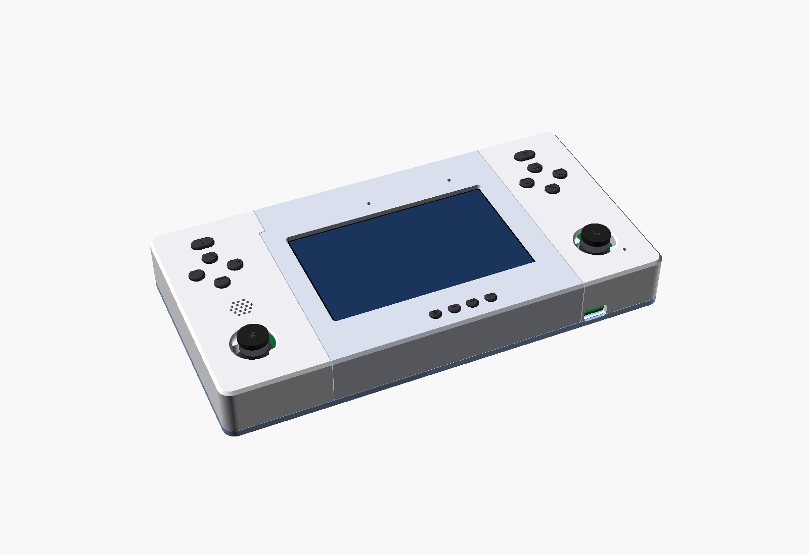

| | |
|---|---|
| Tamaño exterior | 235 × 122,4 × 30,05 mm (esquinas r = 6,5 mm, cantos con chaflán) |
| Material | ≈ 240 g de PLA y ≈ 21,8 h de impresión (con la probeta) |
| Tornillería | 10 × M3×10, 4 × M3×6, 4 tuercas M3, 6 insertos M3. Los joysticks no llevan tornillos |
| Además | Alargador de 40 vías para la pantalla (adaptador + FFC de 100 mm) y 6 tacos de espuma para los joysticks |
| Diseño | OpenSCAD paramétrico (`scad/`). La geometría de la placa sale del `.kicad_pcb` con `scripts/extraer_pcb.py` |
| Cambios | [CAMBIOS.md](CAMBIOS.md): qué ha cambiado en esta versión y qué piezas reimprimir |
| Comprobaciones | Choques, recorridos y tamaños calculados automáticamente: [COMPROBACIONES.md](COMPROBACIONES.md) (todo correcto) |
| Supuestos | [SUPUESTOS.md](SUPUESTOS.md) |

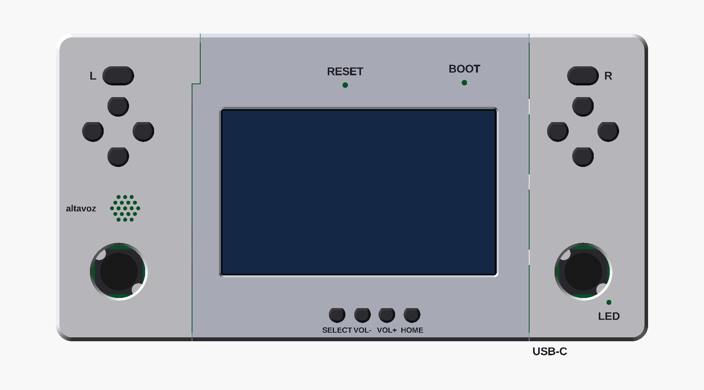

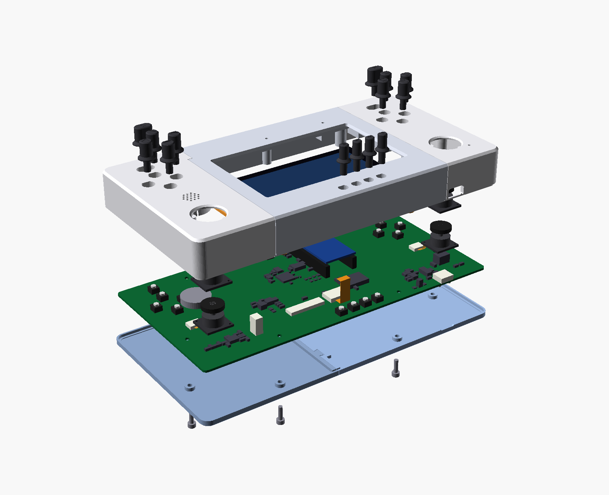

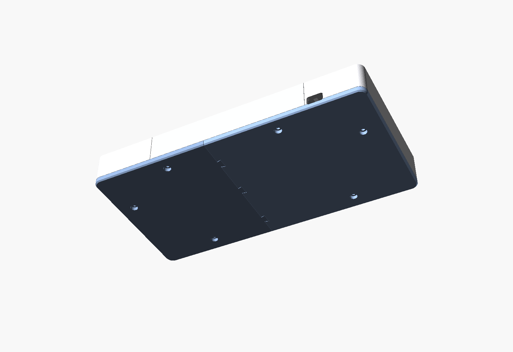

## Cómo está hecha

- **Frontal en tres piezas** (izquierda, central y derecha). La pantalla mide 120,7 mm y con su marco no caben dos mitades de ≤ 135 mm sin partir el marco. Con tres piezas, las uniones quedan fuera de la pantalla: en x = 66,5 (con un escalón a x = 69,8 en el bisel superior para no partir la torreta 65;24) y en x = 200,25. La central lleva la pantalla, su ventana y el marco que la sujeta por delante.
- **Trasera en dos piezas** unidas en x = 115, una franja sin patillas THT. Las juntas de delante y de detrás no coinciden (van a tresbolillo).
- **Uniones**:
  - Las frontales llevan 3 colas de milano ocultas bajo la piel y 2 tornillos M3×10 horizontales con tuerca en cada unión.
  - Las traseras llevan 3 colas de milano en una franja engrosada del suelo.
  - Los 6 tornillos M3 de la placa atraviesan trasera, placa y torreta frontal (con inserto). Así cada trasera une dos frontales.
  - Un labio perimetral de solape alinea la frontal con la trasera.
- **Pila en altura** (z = 0 es la cara de arriba de la placa):

  | Elemento | z |
  |---|---|
  | Tapa trasera | −6,1 |
  | Hueco para soldaduras | −4,1 a −1,6 |
  | Placa | −1,6 a 0 |
  | DevKit (punto más alto) | 15,9 |
  | 1,5 mm de aire | 15,9 a 17,4 |
  | Pantalla | 17,4 a 21,95 |
  | Cara frontal (piel de 2 mm) | 21,95 a 23,95 |
- **Capuchones**: cuerpo en «D» o en estadio, que no gira. Un tubo guía de 6 mm con 0,3 mm de holgura. Una brida-tope de 45° bajo el tubo evita que se salgan. El pie apoya en el vástago del pulsador.
- **RESET** queda fuera de la pantalla: agujero de Ø 2,2 mm con un tubo que lleva el clip hasta el vástago.
- **BOOT** queda **debajo de la pantalla**, así que lleva un **empujador en L**: se pulsa con un clip por un agujero del bisel superior, y un brazo por debajo de la pantalla pisa el pulsador.
- **Antena**: sobre la muesca solo pasa la piel frontal de 2 mm. No hay nervios, torretas ni tornillos en esa zona; el tornillo más cercano está a 19 mm.
- **Joysticks**: cada módulo va **al sur** de su conector (J6 o J7), girado 180°, con el eje en (37,5; 105,7) y (221,8; 105,7). El cable sale por el borde norte del módulo, a 13,45 mm sobre la placa, y baja con una S suave hasta J6/J7. Entra recto hacia el norte con los contactos arriba, sin doblarse nunca sobre sí mismo. Como el cable es corto, el módulo no se atornilla: viaja pegado a la placa sobre tres tacos de espuma y, al cerrar, la frontal lo aprieta contra sus postes.
- **Altavoz**: entre la cruceta y el joystick izquierdo, en (40; 80,5).
- **Pantalla**: su FPC de 40 pines no llega a J1. La parte ancha (con el blindaje) va pegada a la trasera y no se dobla, y la cola, doblada hacia atrás, baja como mucho ~11 mm. Lleva un **alargador**: un adaptador pegado a la trasera de la pantalla, al final de la cola, y un FFC de 40 vías que vuelve por debajo de la pantalla hasta J1.

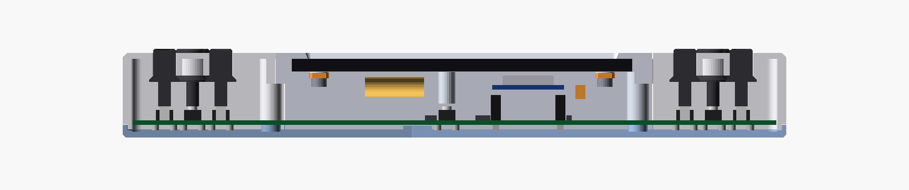

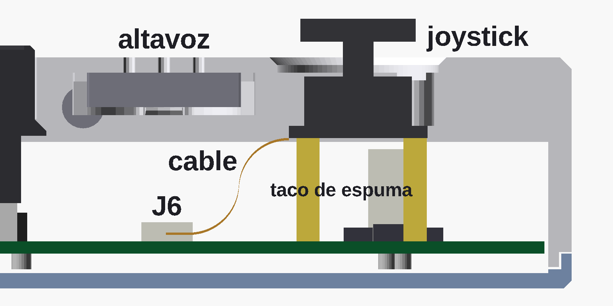

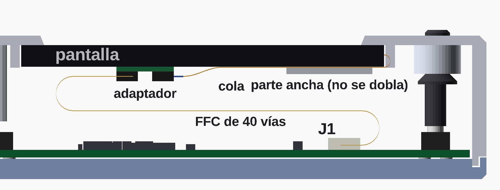

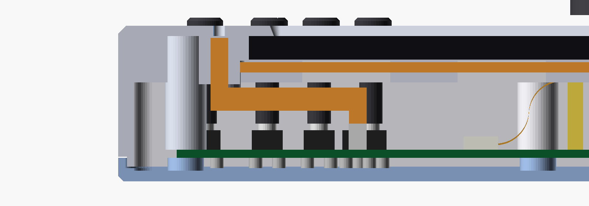

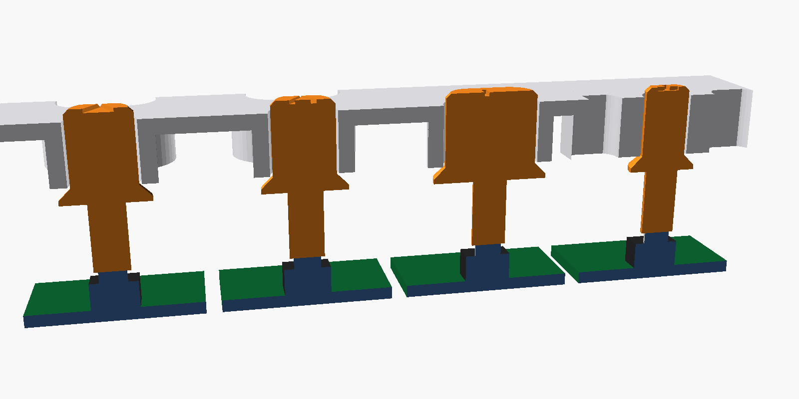

---

## 1. Piezas que imprimir

Los STL de `stl/` ya están orientados, centrados y apoyados en la cama. No los gires.

| # | Pieza | Archivo | Cant. | Orientación en la cama | Tamaño (mm) | PLA | Tiempo* |
|---|---|---|---|---|---|---|---|
| 0 | Probeta de ajuste (opcional, imprímela primero) | `stl/00_probeta_ajustes.stl` | 1 | Placa sobre la cama | 64 × 28 × 11 | 7 g | 0 h 41 |
| 1 | Frontal izquierda (cruceta, L, joystick izq., altavoz) | `stl/01_frontal_izquierda.stl` | 1 | Boca abajo: cara frontal sobre la cama | 57,3 × 122,4 × 27,2 | 44 g | 4 h 02 |
| 2 | Frontal central (pantalla, SELECT/VOL/HOME, RESET, BOOT) | `stl/02_frontal_central.stl` | 1 | Boca abajo | 133,4 × 122,4 × 27,2 | 61 g | 5 h 48 |
| 3 | Frontal derecha (ABXY, R, joystick der., LED, USB-C) | `stl/03_frontal_derecha.stl` | 1 | Boca abajo | 50,6 × 122,4 × 27,2 | 39 g | 3 h 34 |
| 4 | Trasera izquierda | `stl/04_trasera_izquierda.stl` | 1 | Cara exterior sobre la cama | 105,8 × 122,4 × 4,5 | 32 g | 2 h 30 |
| 5 | Trasera derecha | `stl/05_trasera_derecha.stl` | 1 | Cara exterior sobre la cama | 132,4 × 122,4 × 4,5 | 41 g | 3 h 09 |
| 6 | Pisapantalla izquierdo | `stl/06_pisapantalla_izq.stl` | 1 | Plano | 7 × 91,4 × 2 | 1 g | 0 h 06 |
| 7 | Pisapantalla derecho | `stl/07_pisapantalla_der.stl` | 1 | Plano | 7 × 91,4 × 2 | 1 g | 0 h 06 |
| 8 | Empujador de BOOT | `stl/08_empujador_boot.stl` | 1 | Tumbado de lado | 16,5 × 30,1 × 3,4 | 1 g | 0 h 04 |
| 9 | Bandeja con los 14 capuchones | `stl/09_bandeja_capuchones.stl` | 1 | Boca abajo: cara superior sobre la cama | 67 × 64,5 × 20,4 | 13 g | 1 h 48 |
| — | Capuchones sueltos (para reponer) | `stl/capuchones/capuchon_SWx_*.stl` | 0 | Boca abajo | ≤ 15 × 10 × 20,4 | 1 g | ~0 h 10 |
| | **Total** | | | | | **≈ 240 g** | **≈ 21,8 h** |

\* Estimación de PrusaSlicer 2.7 con un perfil aproximado de la Finder (`perfil/finder_pla_0.2.ini`). FlashPrint puede dar ±20 %. Las piezas 6, 7 y 8 se pueden imprimir juntas.

| | | |
|---|---|---|
| 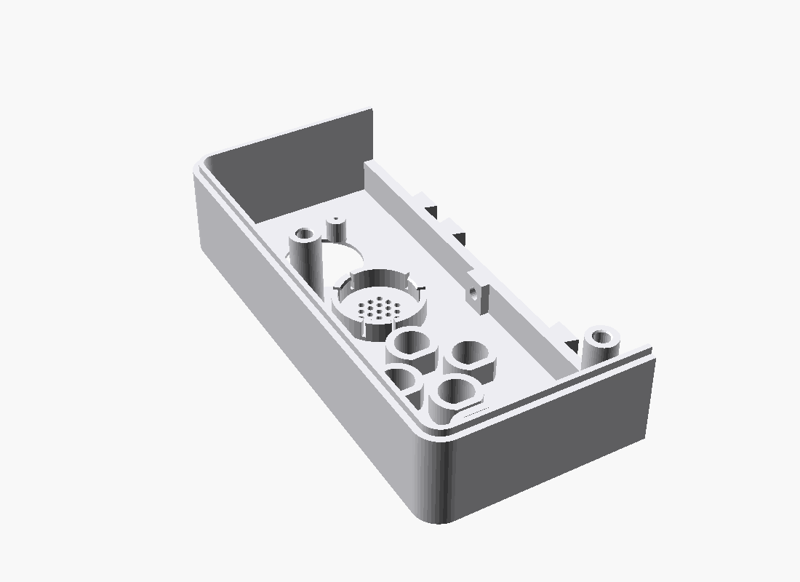 01 frontal izquierda | 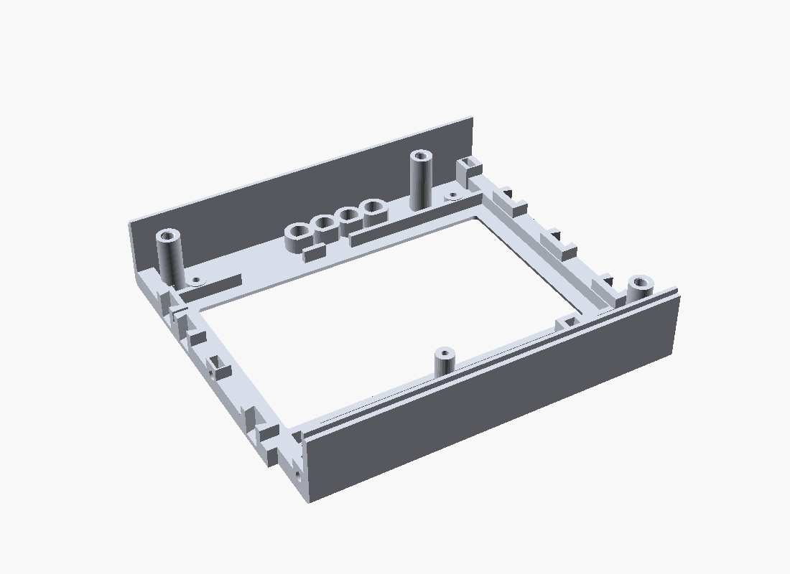 02 frontal central | 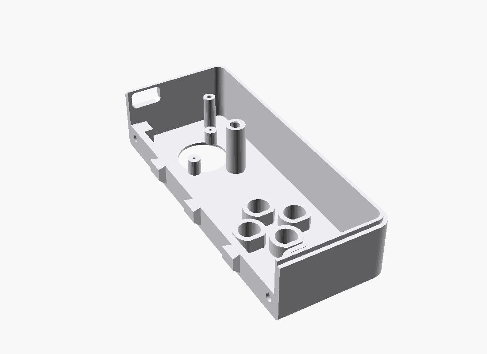 03 frontal derecha |
| 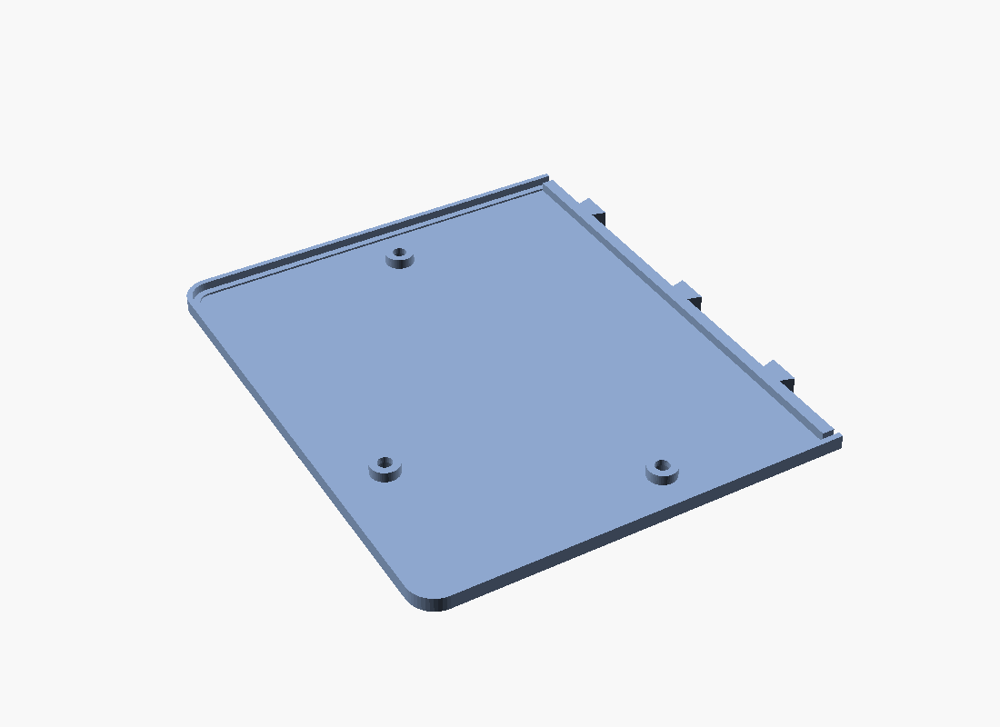 04 trasera izquierda | 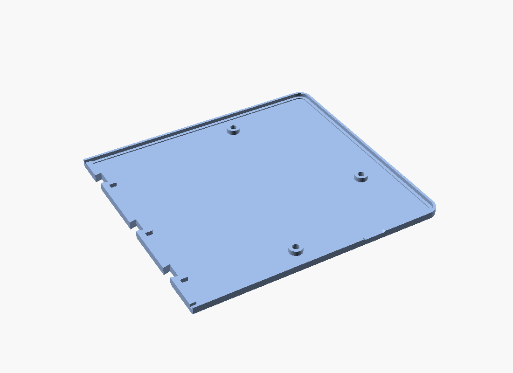 05 trasera derecha | 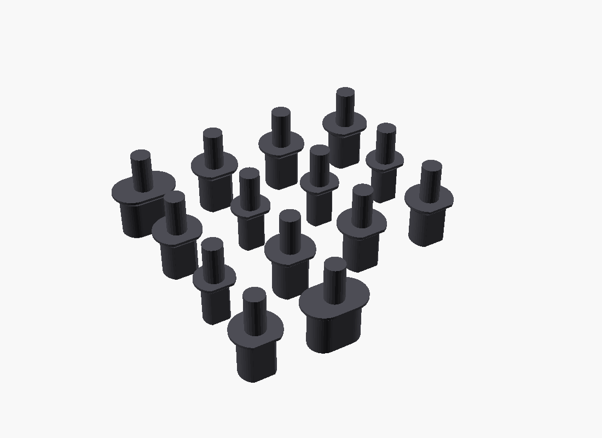 09 capuchones |
| 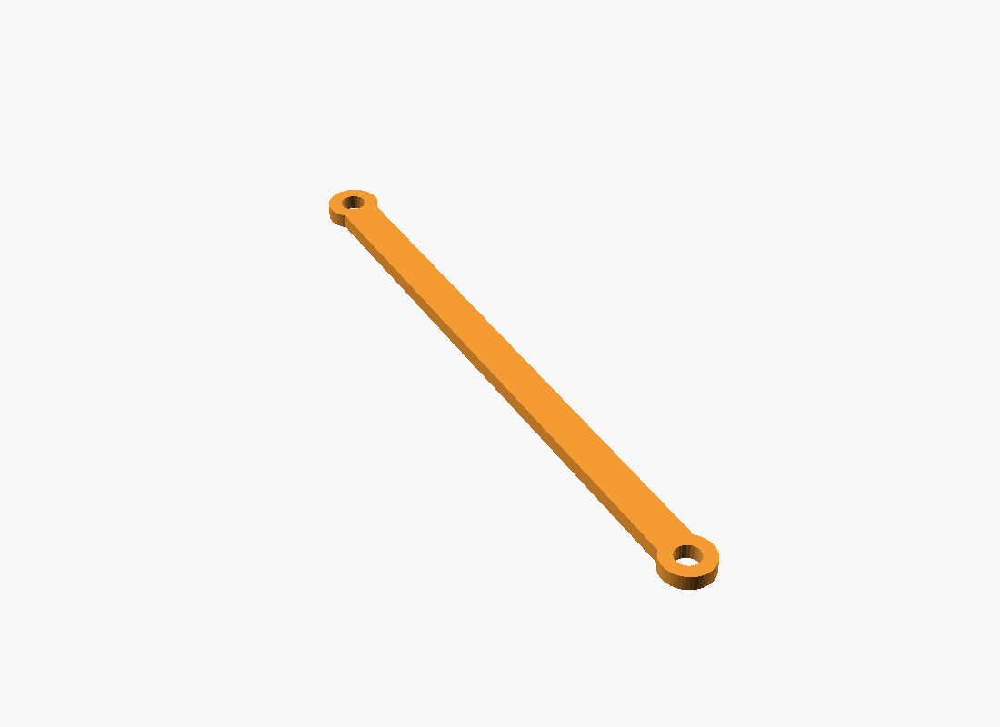 06 / 07 pisapantallas | 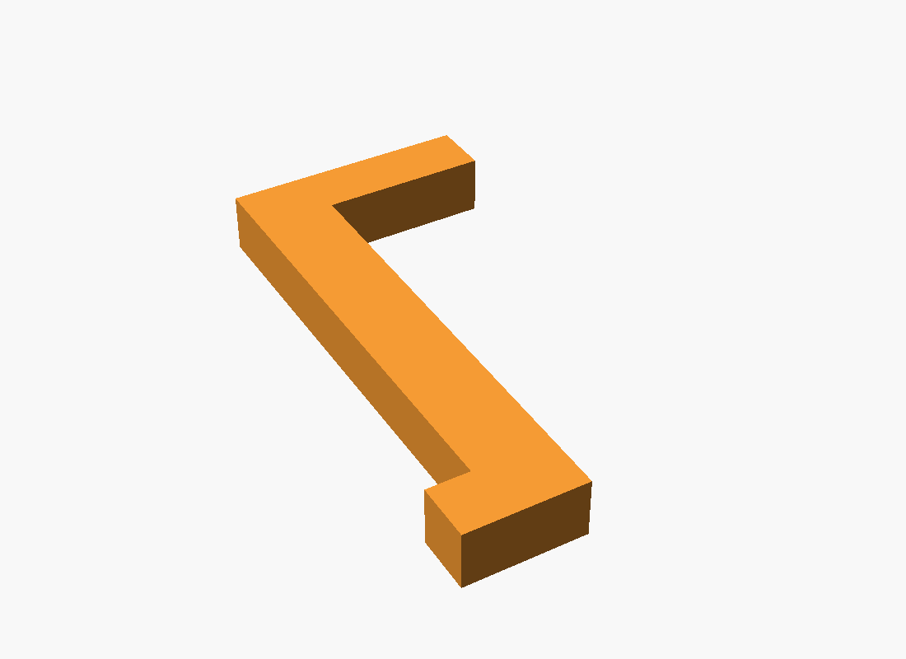 08 empujador de BOOT | 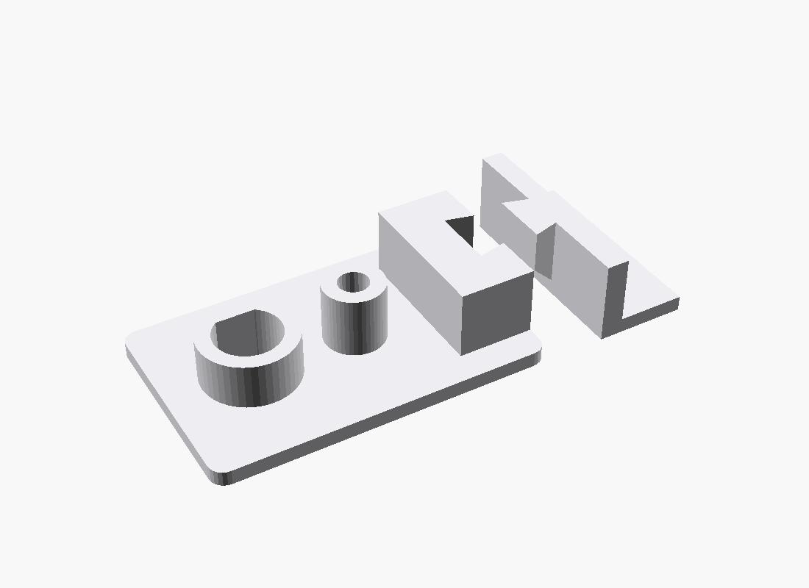 00 probeta |

### Antes de las piezas grandes: la probeta (40 min)

La probeta trae:
- una guía de capuchón ABXY;
- una torreta con el agujero del inserto;
- una cola de milano hembra y su macho.

Imprime también `stl/capuchones/capuchon_SW13_T_triangulo.stl` y comprueba:
- **Capuchón**: debe bajar y subir solo en la guía, sin holgura lateral apreciable. Si roza, sube `holgura` a 0,35–0,4. Si baila mucho, bájala a 0,25.
- **Cola de milano**: el macho entra de arriba abajo con la mano. Si hay que forzarla, sube `holgura`.
- **Inserto**: debe entrar con el soldador y quedar recto. Si se hunde solo, baja `inserto_d`; si no entra, súbelo.

Vuelve a generar los STL (apartado 6) si cambias algo.

## 2. Ajustes de impresión (Finder sin cama caliente)

| Ajuste | Valor recomendado |
|---|---|
| Material | PLA de 1,75 mm |
| Temperatura | 205 °C (210 °C en la primera capa). La cama no se calienta |
| Altura de capa | 0,2 mm; primera capa 0,3 mm |
| Perímetros | 3 (1,2 mm). Las paredes de 2 y 3 mm quedan casi macizas |
| Capas superiores / inferiores | 5 / 4 |
| Relleno | 20 %, rejilla o panal |
| Velocidad | 40 mm/s perímetros, 30 mm/s perímetro exterior, 60 mm/s relleno, **20 mm/s primera capa** |
| Ventilador | Apagado en las 3 primeras capas, luego al 100 % |
| Soportes | **No.** Ninguna pieza los necesita: las colas de milano llevan cuña de 45°, los agujeros horizontales son en lágrima y las ranuras de tuerca están abiertas hacia arriba |
| Adhesión | Placa limpia con alcohol y una capa fina de barra de pegamento (o cinta de pintor azul). Borde (*brim*) de **3 mm como máximo** en las piezas 1 a 5 y en la bandeja de capuchones. La central mide 133,4 mm: con un borde de 5 mm no cabe en 140 mm. Mejor sin balsa (*raft*) |
| Otros | Nivela la cama antes de las piezas grandes. Imprime en una habitación sin corrientes. Si se levanta una esquina, la culpa suele ser la adhesión o la primera capa demasiado alta, no la temperatura |

Los capuchones son altos y finos (20 mm). Imprímelos todos juntos para que cada capa tenga tiempo de enfriarse (bandeja 09). Si alguno se tambalea, añade un borde de 3 mm.

## 3. Tornillería y material

| Cant. | Pieza | Dónde va |
|---|---|---|
| 10 | Tornillo M3 × 10 DIN 912 (Allen, cabeza Ø 5,5) | 6 desde la trasera a través de la placa (agujeros M3 del PCB) y 4 horizontales en las uniones frontales |
| 4 | Tornillo M3 × 6 DIN 912 | Pisapantallas (más largo asomaría por la cara frontal) |
| 4 | Tuerca M3 DIN 934 | Ranuras de la frontal central (uniones) |
| 6 | Inserto térmico M3 × 5,7 mm, Ø ext. 4,6 mm (tipo ruthex RX-M3x5.7) | Extremo de las 6 torretas frontales. Sin soldador: `fijacion_pcb = "autorroscante"` y los M3×10 roscan en el PLA |
| 1 | Adaptador (alargador) FPC/FFC de 40 vías a 0,5 mm, unos 30 × 12 × 3 mm, con un conector en cada canto largo | Pegado a la trasera de la pantalla, al final de su cola |
| 1 | Cable FFC de 40 vías a 0,5 mm y 100 mm (vale desde 84 mm) | Del adaptador a J1. Tipo A (contactos en la misma cara) o B (en caras opuestas): ver el paso 7 |
| 6 | Taco de espuma (EVA o goma) de unos 4 × 3 mm y 14 mm de alto, con cinta de doble cara en las dos caras. Sirven también tiras de cinta de espuma apiladas | 3 bajo cada joystick |
| 4 tiras | Cinta de espuma de doble cara de 0,5 mm, 5 × 80 mm | Entre los pisapantallas y la trasera de la pantalla |
| 1 tira | Cinta de doble cara fina (≤ 0,2 mm), 30 × 12 mm | Para pegar el adaptador a la trasera de la pantalla |
| 22 mm | Filamento transparente o natural de 1,75 mm | Tubo de luz del LED D2 |
| — | Altavoz de Ø 20 mm con su cable JST PH de 2 pines | J5 |

**Herramientas:**
- soldador con punta para insertos (≈ 220 °C);
- llave Allen de 2,5 mm;
- pinzas y cúter o lima para rebabas;
- un alfiler, para centrar los joysticks;
- un clip desplegado (Ø 0,8–1 mm) para RESET y BOOT.

## 4. Montaje paso a paso

Casi todo el montaje se hace con la frontal **boca abajo** sobre una mesa limpia (pon un paño para no rayar la cara).
En las imágenes, lo que añades en cada paso sale en naranja.

### Paso 1. Insertos térmicos
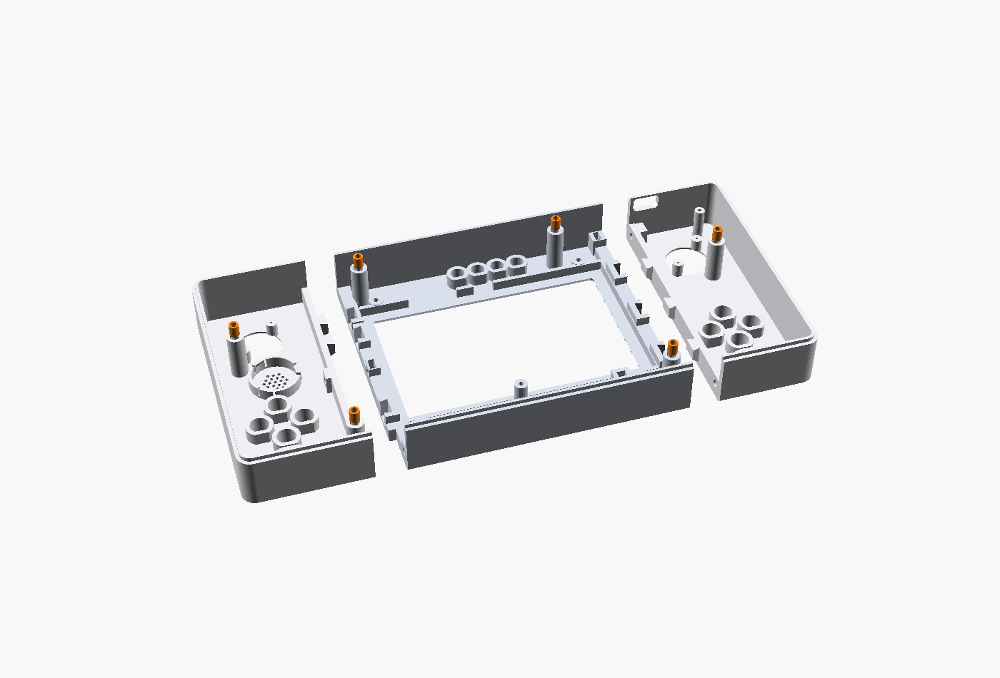

Con cada frontal boca abajo, mete un inserto M3 en el extremo de cada torreta:
- 2 en la izquierda: (65;24) y (26;92);
- 3 en la central: (76;122), (173;122) y (195;24);
- 1 en la derecha: (230;92).

Apoya el inserto, caliéntalo y empuja recto hasta que quede **a ras o 0,2 mm por debajo**. Si sobresale, la placa no asienta.

### Paso 2. Unir las tres frontales
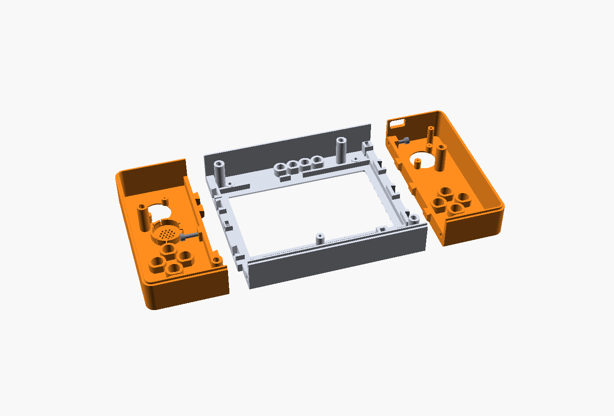

1. Mete una tuerca M3 en cada una de las **4 ranuras de la frontal central**: dos en cada costado, por la ranura abierta hacia dentro. Empújala hasta que el agujero quede centrado.
2. Con la central boca abajo, baja la **frontal izquierda** en vertical. Sus 3 colas de milano (ocultas bajo la piel) entran en las hembras de la central. Sigue hasta que su cara frontal toque la mesa: las dos caras deben quedar a ras.
3. Atornilla 2 × M3 × 10 horizontales desde la izquierda, uno arriba y otro a la altura de la cruceta, con la llave de 2,5 mm.
4. Repite con la **frontal derecha**: 3 colas y 2 × M3 × 10 (arriba y abajo).

Aprieta con suavidad: el PLA cede si te pasas.

### Paso 3. Capuchones
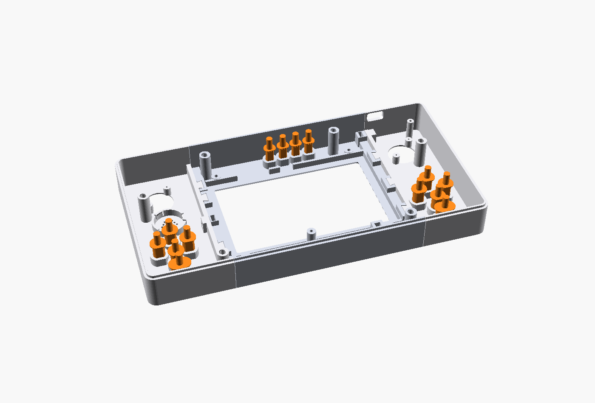

Deja caer cada capuchón en su guía con la **cara superior hacia la mesa**. El plano de la «D» va hacia el borde superior de la consola; los gatillos L/R son ovalados.

| Grupo | Capuchones |
|---|---|
| Cruceta | Flechas: SW2 arriba, SW3 derecha, SW4 izquierda, SW5 abajo |
| Botones de acción | △ SW13 arriba, ○ SW11 derecha, ✕ SW10 abajo, □ SW12 izquierda |
| Gatillos | L (SW1) y R (SW15) |
| Fila de abajo | SELECT (≡), VOL− (−), VOL+ (+), HOME (casa) |

La brida queda apoyada en el extremo del tubo.

### Paso 4. Pantalla, alargador, pisapantallas y empujador de BOOT
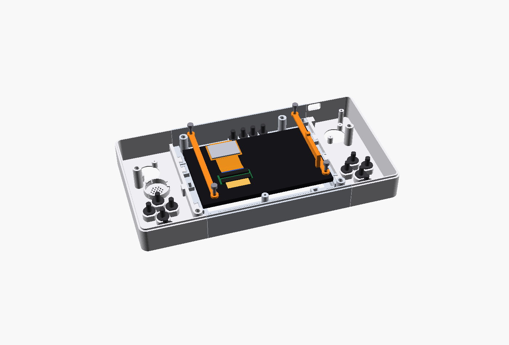

1. Limpia el vidrio y la ventana. Mete la pantalla en su bolsa con el **vidrio hacia la ventana** y los **dos FPC hacia el borde inferior** de la consola, por las dos ranuras del marco inferior: el de 40 pines a la izquierda y el del táctil a la derecha.
2. **FPC de 40 pines**: dobla el cuello sobre el canto de la pantalla y deja la parte ancha (la del blindaje metálico) plana sobre la trasera. No la dobles. La cola sigue plana por la trasera, hacia el borde de los gatillos.
3. **Adaptador**: mete el extremo de la cola en uno de sus conectores y cierra la palanca. Pega el adaptador a la trasera de la pantalla con la cinta fina, justo donde acaba la cola, centrado con ella y con los conectores hacia fuera (hacia donde irá la placa). Queda a unos 44 mm del borde inferior de la pantalla, lejos de la DevKit (ver la sección de la pantalla).
4. Mete el **FFC** en el otro conector del adaptador y cierra la palanca. Déjalo suelto: se conecta a J1 en el paso 7.
5. Pega una tira de espuma de 0,5 mm en cada pisapantalla, apóyalos sobre la trasera metálica de la pantalla con las orejas sobre las torretas y atornilla 4 × M3 × 6. Para cuando la pantalla deje de moverse. No tapan el adaptador.
6. **Empujador de BOOT**: mete su varilla cuadrada en la guía cuadrada del bisel superior, encima del DevKit, a la derecha. El brazo queda tumbado sobre la trasera de la pantalla, hacia el centro, con el dedo hacia arriba. Va después de la pantalla porque el brazo pasa por encima de ella.

### Paso 5. Joysticks (sin tornillos)
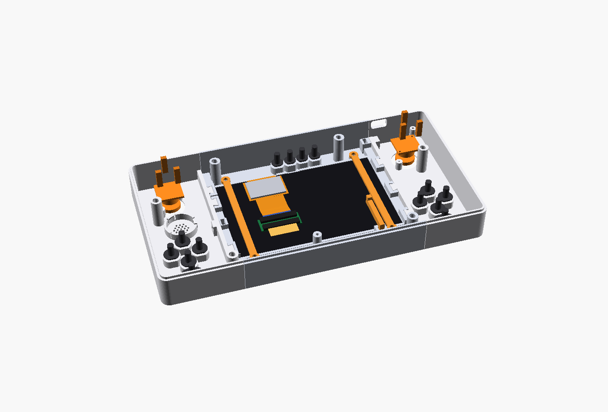

El cable del joystick es corto: con la placa abierta no llega a J6/J7, y con la placa en su sitio J6/J7 quedan tapados. Por eso el módulo no se atornilla: se pega a la placa con tres tacos de espuma y, al cerrar, la frontal lo aprieta contra sus postes. Aquí la frontal sirve de plantilla para que los tacos queden en su sitio.

1. Pasa el capuchón del stick por el hueco circular desde dentro, con la salida del cable hacia el **borde de los gatillos**: J6 y J7 quedan a ese lado del módulo.
2. Apoya las orejas en sus dos postes, con los agujeros de las orejas encima de los de los postes (céntralo con un alfiler y quítalo).
3. Pega en la parte de atrás de cada módulo los **3 tacos de espuma** (unos 14 mm de alto, con cinta en las dos caras):
   - dos en las esquinas del lado del cable, dejando libres los ~9 mm del centro, por donde sale el cable;
   - uno en el centro del lado contrario.

   Así caen sobre placa sin componentes. En el derecho, los tacos rodean C40 sin tocarlo.

### Paso 6. Altavoz
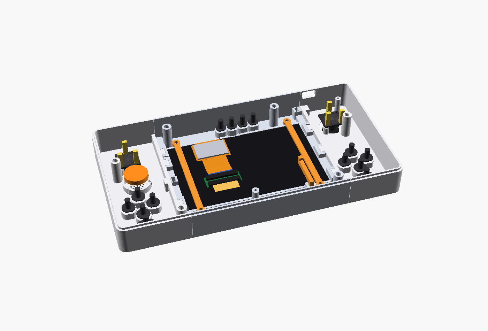

El altavoz va entre la cruceta y el joystick izquierdo. Mételo en su aro, con el cono hacia la rejilla, hasta que los tres ganchos hagan clic. Si queda flojo, pon una gota de termofusible en el borde (no en el cono). Deja el cable hacia J5.

### Paso 7. Presentar la placa y conectar los cables
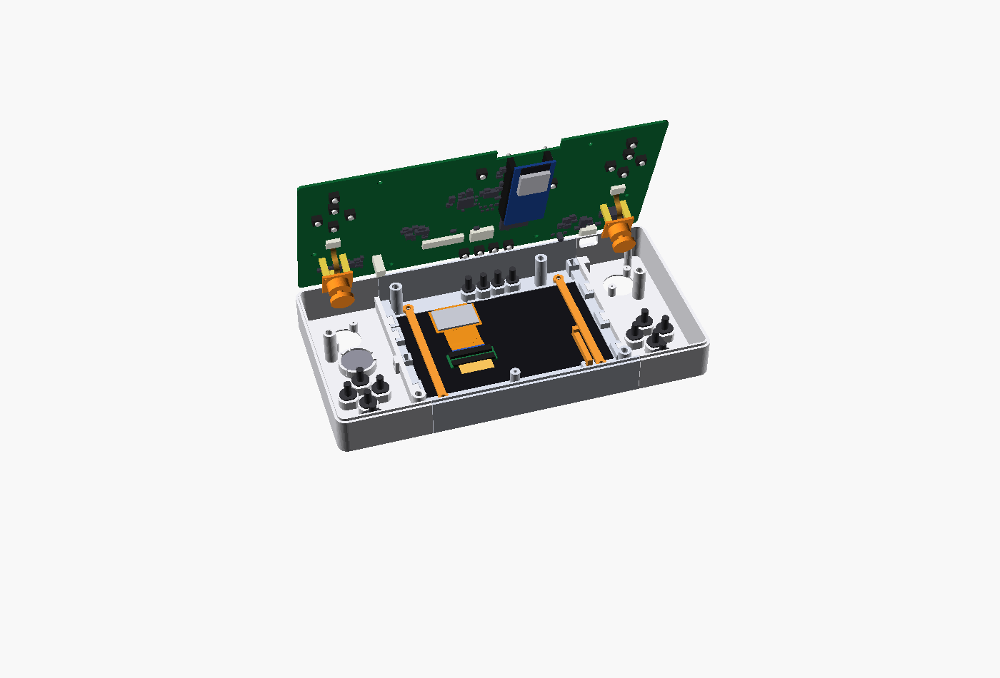

1. Con el DevKit ya en sus zócalos, baja la placa sobre la frontal, en su sitio y sin conectar nada. Aparta antes el FFC y el FPC del táctil para que no se pellizquen. Aprieta encima de cada joystick: sus tacos se pegan a la placa justo debajo del módulo.
2. Levanta la placa girándola sobre su **borde inferior** (el del USB-C) y déjala de canto junto a la frontal, como la tapa de un libro abierto. Los joysticks salen de sus huecos pegados a la placa.
3. Conecta y cierra las palancas:
   - el cable de cada joystick en **J6** (izquierdo) o **J7** (derecho). Entra recto hacia el borde de los gatillos, con los contactos hacia arriba (el pin 1 de J6/J7 está al oeste), y baja del módulo con una S suave. No lo dobles sobre sí mismo;
   - el **FFC** en **J1**. Con la vuelta que hace, la cara que mira a la pantalla en el adaptador es la que queda arriba en J1: elige el FFC de tipo A o B según qué cara de contactos pidan el adaptador y J1;
   - el FPC del táctil en **J4**;
   - la clavija del altavoz en **J5**.

### Paso 8. Cerrar la placa
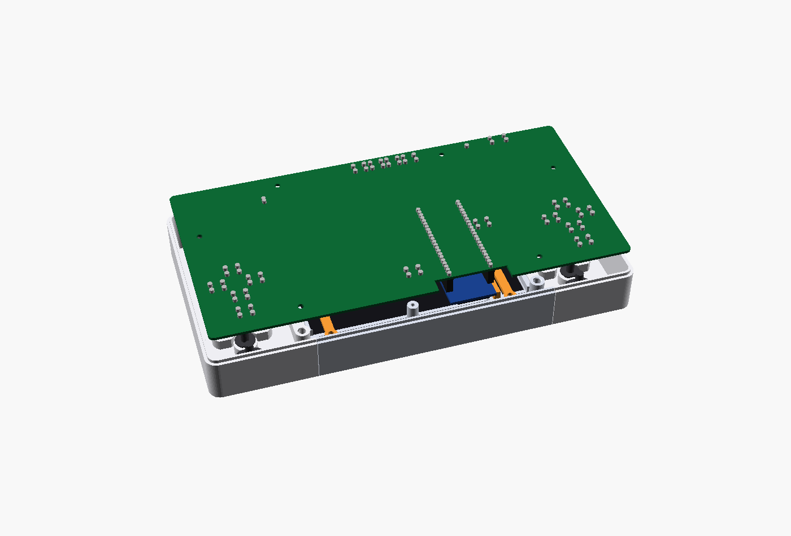

Abate la placa sobre la frontal como quien cierra un libro. Mientras baja, guía:
- el **FFC**: se dobla sobre el adaptador, vuelve plano por debajo de la pantalla y hace otra vuelta junto a J1 (ver la sección de la pantalla);
- el **FPC del táctil**: se dobla hacia atrás sin pellizcarse en el borde inferior de la pantalla;
- los **sticks**: entran en sus huecos. Al final el capuchón roza el borde del hueco y se inclina un poco: es normal.

La placa apoya en las 6 torretas. Entonces:
- los tacos aprietan cada joystick contra sus postes;
- los vástagos de los pulsadores tocan los pies de los capuchones;
- el de BOOT toca el dedo del empujador;
- el USB-C queda frente a su hueco.

### Paso 9. Tapas traseras
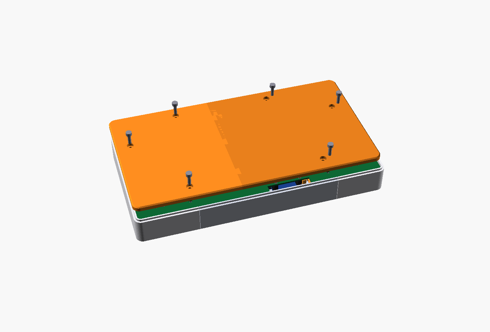

Coloca la **trasera derecha** y luego la **izquierda**: sus 3 colas de milano bajan en vertical en las hembras de la derecha. El labio de la frontal entra en el rebaje perimetral de las traseras.

Atornilla los **6 × M3 × 10** desde atrás, en cruz, hasta que las cabezas asienten en sus alojamientos.

### Paso 10. Comprobación final


1. Da la vuelta a la consola. Pulsa cada botón: debe hacer clic (≈ 0,25 mm) y volver solo. Los capuchones tienen 0,4 mm de juego vertical, es normal que suenen un poco. Mueve los sticks en círculo: tienen que volver solos al centro sin rozar el hueco.
2. Mete el trozo de filamento transparente (≈ 22 mm) en el agujero del **LED** y córtalo a ras.
3. **RESET**: clip por el agujero izquierdo del bisel superior. **BOOT**: clip por el agujero derecho (ver la vista en planta).
4. **Modo de descarga del ESP32-S3**: mantén BOOT, pulsa y suelta RESET, y luego suelta BOOT.
5. Conecta el cable USB-C: la funda (12,5 × 7 mm) entra en el hueco hasta el fondo. Por J10 se alimenta, se programa y se ve la consola serie (el USB-Serial/JTAG del ESP32-S3), sin abrir nada.

**Para desmontar:** quita los 6 tornillos de atrás y las traseras, y levanta la placa por el borde superior: gira sobre su borde inferior con los cables puestos, y los joysticks salen pegados a ella. Para programar no hace falta abrir: basta con J10.

## 5. Qué medir de tus piezas y qué parámetro cambiar

Mide con calibre y cambia el valor en [`scad/parametros.scad`](scad/parametros.scad). Después regenera (apartado 6): las comprobaciones dirán si algo choca.

| Qué medir | Cómo | Parámetro | Por defecto | Qué reimprimir |
|---|---|---|---|---|
| Grosor de la pantalla (vidrio + LCD) | Calibre en el canto, lejos del FPC | `pantalla_grosor` | 4,55 mm | Frontal central y pisapantallas |
| Contorno de la pantalla | Calibre | `pantalla_ancho`, `pantalla_alto` | 120,7 × 75,8 | Frontal central y pisapantallas |
| Posición de la zona visible | Distancia del borde negro a cada lado del contorno | `ventana`, `ventana_desplaz` | 109 × 65,8, centrada | Frontal central |
| FPC de 40 pines de la pantalla: cuello, parte ancha (largo, ancho y grosor con el blindaje), cola y extremo rígido | Calibre y regla | `tft_cuello`, `tft_ancha_largo`, `tft_ancha_ancho`, `tft_ancha_e`, `tft_cola_largo`, `tft_extremo` | 5 · 21 · 30 · 1,5 · 20 · 5,5 | Nada: el adaptador se pega donde acabe la cola. Regenera para comprobar que no toca nada |
| Adaptador del alargador y largo del FFC | Calibre y regla | `adaptador`, `adaptador_ranura_z`, `ffc_largo` | 30 × 12 × 3 · 1,0 · 100 | Nada: las comprobaciones dicen si el adaptador cabe y si el FFC llega |
| Largo del FPC del táctil y su posición en el borde | Regla | `pantalla_borde_inf` (sube 1–3 mm si el FPC del táctil no llega a J4), `fpc_tft_ancho`, `fpc_ctp_ancho` | 112,0 · 24 · 10 | Frontal central y pisapantallas |
| Altura del DevKit montado (de la placa a lo alto del módulo) | Calibre de profundidad | `zocalo_alto`, `pin_plastico`, `devkit_modulo_alto` | 8,5 + 2,5 + 1,6 + 3,3 = 15,9 | Todas las frontales y los capuchones (cambia la altura de la cara frontal) |
| Base del joystick | Calibre | `joy_base` | 19 × 18 | Frontal izquierda y derecha |
| Agujeros de las orejas del joystick (distancia entre ellos y al eje): los postes apoyan ahí | Calibre | `joy_agujeros`, `joy_tornillo_d`, `joy_piloto_d` | (±7,75; ±7,25), Ø 1,6 / 1,2 | Frontal izquierda y derecha |
| Altura del joystick (base → capuchón, base → cúpula) | Calibre de profundidad | `joy_total_alto`, `joy_cuerpo_alto`, `joy_cuerpo_d` | 15,5 · 8 · 14 | Frontal izquierda y derecha |
| Capuchón del stick e inclinación | Calibre y transportador | `joy_cap_d`, `joy_inclinacion`, `joy_agujero_d` | 15 · 20° · 21 | Frontal izquierda y derecha |
| Cuánto quieres que asome el stick | — | `joy_sobresale` | 5 mm | Frontal izquierda y derecha |
| Largo del cable del joystick, del borde del módulo a la punta | Regla | `joy_fpc_largo` | 24 (ahora caben de 21,0 a 32,4: lo dice [COMPROBACIONES.md](COMPROBACIONES.md)) | Nada si está en ese margen. Si no, mueve el módulo (`joy_izq`, `joy_der`) y reimprime la frontal izquierda y la derecha |
| Dónde sale el cable del módulo (desvío respecto al eje) y a qué altura | Calibre | `joy_fpc_desplaz`, `joy_fpc_z` | 0 · 0 | Frontal izquierda y derecha (el eje tiene que quedar alineado con J6/J7) |
| Posición y giro del joystick | — | `joy_izq`, `joy_der`, `joy_giro_izq`, `joy_giro_der` | (37,5;105,7), (221,8;105,7), 180° | Frontal izquierda y derecha |
| Tacos de espuma bajo el joystick | — | `joy_tacos`, `joy_taco` | 3 tacos de 4 × 3 mm, ~14 mm de alto | Nada |
| Diámetro y grosor del altavoz | Calibre | `altavoz_d`, `altavoz_alto` | 20 · 4,5 | Frontal izquierda |
| Altura real de los pulsadores soldados | Calibre de profundidad desde la placa | `sw_alto` | 5,0 | Capuchones |
| Botón que queda pulsado o que no llega | — | `cap_juego` (o lija 0,2 mm el pie) | 0,4 | Capuchones |
| Funda del cable USB-C | Calibre | `usb_funda`, `usb_funda_radio` | 12,5 × 7, r 1,5 | Frontal derecha y trasera derecha |
| Encajes demasiado justos o flojos | Probeta | `holgura` | 0,3 | Lo que no encaje |
| Agujero del inserto | Probeta | `inserto_d`, `inserto_l` | 4,0 · 6,0 | Frontales |

## 6. Cómo regenerar los STL, las imágenes y las comprobaciones

Hace falta:
- OpenSCAD 2021.01 o posterior;
- Python 3 con `numpy`, `trimesh` y `manifold3d` (`pip install numpy trimesh manifold3d`);
- para las imágenes sin pantalla, `xvfb-run`;
- para la estimación, opcionalmente PrusaSlicer.

Para regenerarlo todo:

```bash
python3 carcasa/scripts/construir.py
```

Esto ejecuta, por orden:
- `extraer_pcb.py`: el `.kicad_pcb` → `scad/pcb_data.scad`;
- OpenSCAD para cada pieza → `build/montaje/` y `stl/`;
- `comprobar.py` → `COMPROBACIONES.md`;
- `renders.py` → `img/`.

Para recalcular tiempo y filamento:

```bash
python3 carcasa/scripts/estimar_impresion.py
```

Para sacar una sola pieza desde OpenSCAD (también desde la interfaz: abre `scad/carcasa.scad`, cambia `pieza` y pulsa F6):

```bash
openscad -D 'pieza="frontal_central"' -o frontal_central.stl carcasa/scad/carcasa.scad
```

Con `-D 'modo="montaje"'` la pieza sale en su posición sobre la placa. `pieza="ensamblaje"` y `pieza="explosionado"` muestran el conjunto.

## 7. Comprobaciones automáticas

`scripts/comprobar.py` usa booleanas exactas (manifold3d) sobre las piezas montadas. El resultado completo está en [COMPROBACIONES.md](COMPROBACIONES.md). Ahora mismo todo pasa:

1. **Tamaño**: las 10 piezas y los 14 capuchones sueltos miden ≤ 135 mm (la mayor, 133,4 mm).
2. **Choques con componentes**: ninguna pieza toca ninguna de las 276 zonas prohibidas, entre ellas:
   - cada componente con su altura;
   - el DevKit, la pantalla y su FPC (cuello, parte ancha y cola), el adaptador y el FFC del alargador, y el FPC del táctil;
   - el paso del cable de cada joystick, sus tacos de espuma, el altavoz y la clavija USB-C;
   - las patillas THT bajo la placa y la **zona de la antena**.
3. **Choques entre piezas montadas**: ninguno de los 231 pares se solapa.
4. **Capuchones y empujador**:
   - bajan 1,25 mm libres (el clic está a 0,25 mm);
   - suben solo 0,4 mm hasta el tope, así que no se salen;
   - sobresalen 1,2–1,5 mm, y aún 0,95–1,25 mm cuando están pulsados.
5. **Joysticks**:
   - el stick inclinado 20° en 24 direcciones no toca la carcasa;
   - el cable se calcula como una tira elástica sujeta en horizontal por sus dos extremos (la forma que toma solo). Con 24 mm llega a J6/J7 con una S de 12,95 mm hacia el norte y 12,3 mm de bajada, con un radio mínimo de 4,2 mm (se pide ≥ 1 mm), sin dar la vuelta y sin tocar piezas, componentes ni la placa;
   - con el módulo donde está caben cables de 21,0 a 32,4 mm. Con menos, el cable se dobla por debajo de 1 mm de radio; con más, la S toca la placa;
   - los tacos de espuma caen sobre placa sin componentes y no tocan el cable.
6. **Tornillos**:
   - ninguno toca componentes ni la antena;
   - los de la placa roscan 6,9 mm en la torreta;
   - los de las uniones atraviesan la tuerca entera.
7. **Voladizos** (informativo): ≤ 100 mm² en cada pieza grande y 205 mm² en la bandeja de capuchones (el fondo de los símbolos grabados y los conos de 45°). Son puentes cortos y caras a 45°, nada que necesite soporte.
8. **Alargador de la pantalla**:
   - sin él no llega: la cola, doblada hacia atrás, baja como mucho 11 mm, y de la trasera de la pantalla a la ranura de J1 hay 16,3 mm;
   - el adaptador queda a 19,6 mm de la DevKit y con 12,6 mm de aire sobre el componente más alto que tiene debajo;
   - el FFC necesita al menos 84 mm (con 100 mm, lo que sobra queda en la vuelta junto al adaptador). Sus vueltas tienen 3,6 mm de radio y no toca piezas, componentes ni la placa.

## 8. Limitaciones conocidas

- **Grosor de 30 mm.** Sale de apilar el DevKit (15,9 mm) bajo la pantalla. Para afinarla habría que sacar el DevKit de debajo de la pantalla o usar un módulo más bajo.
- **Gatillos L/R.** Son pulsadores verticales en la cara de arriba de la placa, a 15,5 mm del borde. Se pulsan desde delante: no hay botones de hombro.
- **BOOT** solo se pulsa con el empujador en L, porque queda debajo de la pantalla. Si programas por J10, `esptool` entra solo en modo de descarga por el USB-Serial/JTAG y no hace falta pulsarlo.
- **Programar por J10.** J10 no es solo alimentación: lleva USB D+/D− (por U2 y R14/R15) a GPIO19/20 del ESP32-S3, su USB-Serial/JTAG. Se programa y se ve la consola por el USB-C de la carcasa, sin abrirla. El USB del DevKit queda dentro y no hace falta. No conectes a la vez J10 y el USB nativo del DevKit: van a las mismas líneas D+/D−.
- **Joysticks sin tornillos.** El cable del joystick es corto: con la placa abierta no llega a J6/J7, y con la placa en su sitio J6/J7 quedan tapados. Ningún orden de montaje permite atornillar el módulo y conectarlo, así que el módulo va pegado a la placa sobre tacos de espuma y la frontal lo aprieta contra sus postes. Los postes conservan los agujeros piloto por si usas un cable más largo.
- **Medidas sin verificar.** Los tramos del FPC de la pantalla salen del plano de Newhaven, pero el ancho y el grosor de su parte ancha, el adaptador y el largo del cable del joystick son supuestos. Tampoco encontré un dibujo acotado del módulo Joy-Con ([SUPUESTOS.md](SUPUESTOS.md)). Mide tus piezas antes de imprimir las frontales.
