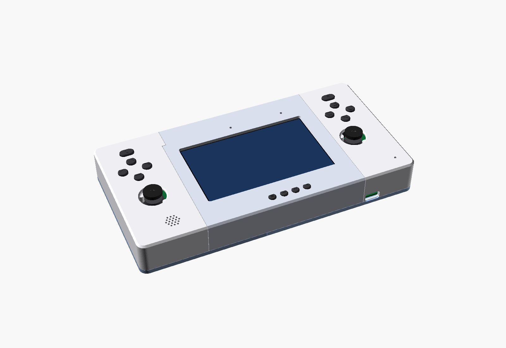

# Carcasa de apoyo OCX

Carcasa imprimible en PLA para la placa principal (`hardware/ocxPrototype.kicad_pcb`). Pensada para una Flashforge Finder: 140 × 140 × 140 mm y sin cama caliente.



| Documento | Qué tiene |
|---|---|
| [MANUAL-MONTAJE.md](MANUAL-MONTAJE.md) | Piezas que imprimir (cantidad, orientación, tiempo y material), ajustes de la Finder, tornillería, montaje en 10 pasos, qué medir y qué parámetro cambiar |
| [SUPUESTOS.md](SUPUESTOS.md) | Tabla de supuestos: de dónde sale cada medida y cómo comprobarla |
| [COMPROBACIONES.md](COMPROBACIONES.md) | Resultado de la comprobación automática de interferencias (se regenera) |

## Carpetas

| Carpeta | Contenido |
|---|---|
| `stl/` | Piezas listas para laminar, ya orientadas. Los capuchones sueltos están en `stl/capuchones/` |
| `img/` | Renders: montado, trasera, planta, explosionado, secciones, cada pieza y los 10 pasos |
| `scad/` | Modelo paramétrico en OpenSCAD: `parametros.scad` (lo que se ajusta), `carcasa.scad` (punto de entrada), `piezas.scad`, `componentes.scad`, `utilidades.scad`, `renders.scad` y `pcb_data.scad` (generado) |
| `scripts/` | `extraer_pcb.py` (lee el `.kicad_pcb`), `construir.py` (lo genera todo), `comprobar.py` (interferencias), `renders.py`, `estimar_impresion.py` |
| `perfil/` | Perfil aproximado de la Finder para PrusaSlicer (solo para estimar) |

## Regenerar

Hace falta OpenSCAD 2021.01 o posterior, Python 3 con `numpy`, `trimesh` y `manifold3d`, y `xvfb-run` si no hay pantalla.

```bash
python3 carcasa/scripts/construir.py
```
