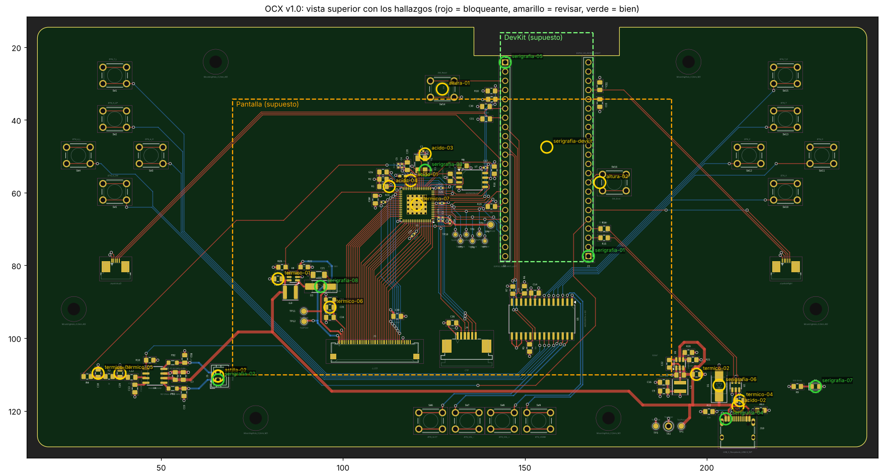

# Revisión DFM / montaje del PCB: `hardware/ocxPrototype.kicad_pcb` (OCX v1.0)

Fecha: 2026-11-01 · Commit analizado: `6948262` (Fab v1.0) · Herramienta: `tools/analyze.py`, que lee el `.kicad_pcb` directamente (sin pcbnew).
No se ha tocado nada de `hardware/`.



## Resultado

| Veredicto | Nº | Resumen |
|---|---|---|
| **Bloqueante** | **0** | No hay nada que impida pedir la placa tal como está. |
| **Revisar** | 19 | 2 de prioridad alta (orientación de la DevKit en serigrafía y hueco bajo la pantalla). El resto son mejoras de prioridad media o baja. |
| **Bien** | 7 hallazgos y 9 comprobaciones generales | Ver la sección «Bien». |

### Prioridad alta (revisar antes de enviar a fabricar)

| ID | Problema | Captura |
|---|---|---|
| `serigrafia-devkit` | Los dos zócalos 1×22 (J2/J3) son idénticos y la DevKit entra también girada 180°. Así, 5V, 3V3 y GND caerían en pines equivocados. En la serigrafía solo se lee «J2»/«J3». Los nombres `ESP32_S3_DEVKIT_LEFT/RIGHT` están en F.Fab, que no se fabrica. **Propuesta:** dibujar el contorno de la DevKit, una flecha «ANTENA →» hacia el recorte y rótulos 3V3/5V/GND en los extremos. | [png](capturas/serigrafia-devkit.png) |
| `altura-pantalla` | La pantalla (120,7 × 75,8 mm) no cabe entre los dos grupos de botones sin quedar encima de la DevKit. La separación mínima entre el PCB y la trasera de la pantalla la marca la pila zócalo 8,5 + PCB DevKit 1,6 + módulo/USB ≈3,3 = **≈13,4 mm**. Sin la DevKit, lo más alto bajo la pantalla serían SW14/SW16 (5 mm) y L2 (3 mm). Hay que reflejarlo en la carcasa: separadores de ≥14 mm o un hueco en el marco. | [png](capturas/altura-pantalla.png) |

### Prioridad media

| ID | Problema | Captura |
|---|---|---|
| `altura-01` | **SW14 (Reset)** queda en el borde superior de la pantalla, en la posición supuesta (y ≈ 34 mm). Con la pantalla montada, seguramente no se podrá pulsar. | [png](capturas/altura-01.png) |
| `altura-02` | **SW16 (Boot)** queda debajo de la pantalla, al lado de J3. Solo es accesible con la pantalla desmontada o con un agujero en la carcasa. Como alternativa, se pueden usar los botones BOOT/RST de la propia DevKit, que quedan igual de tapados, o sacar Reset/Boot por un lateral. | [png](capturas/altura-02.png) |
| `serigrafia-botones` | Los **16/16 pulsadores** muestran solo «SWn» en la serigrafía. El nombre funcional (BTN_X, BTN_A_UP, SW_Boot…) está en F.Fab. Para montar y depurar conviene pasar el Value a F.SilkS o añadir textos: SW1=BTN_T_L, SW2=BTN_A_UP, SW3=BTN_A_R, SW4=BTN_A_L, SW5=BTN_A_DW, SW6=BTN_SLCT, SW7=BTN_VOL_-, SW8=BTN_VOL_+, SW9=BTN_HOME, SW10=BTN_X, SW11=BTN_O, SW12=BTN_C, SW13=BTN_T, SW14=SW_Reset, SW15=BTN_T_R, SW16=SW_Boot. | [png](capturas/serigrafia-botones.png) |
| `termico-07` | En **U1 (BT817Q)**, las 25 vías térmicas del pad expuesto son pads de huella y heredan la conexión de la zona, que es alivio térmico. En In1.Cu (GND) el plano solo cubre ~58 % del anillo de cada vía, porque se ven los radios. Para un pad térmico conviene una conexión maciza: `zone_connect` «Solid» en esos pads o en la huella. Además son vías en pad sin tapar: con Ø0,33 mm es aceptable, y si se quiere evitar que se pierda soldadura existe la opción de via-in-pad taponada. | [png](capturas/termico-07.png) |

### Prioridad baja

| ID | Problema | Captura |
|---|---|---|
| `acido-01` | Ángulo de 45° entre pistas de +3.3V (0,2 mm) en (118,64; 56,64), junto a U1. | [png](capturas/acido-01.png) |
| `acido-02` | Ángulo de 45° entre pistas de +5V (0,8 mm) en (208,58; 118,75), junto a J10. | [png](capturas/acido-02.png) |
| `acido-03` | Ángulo de 45° entre pistas de GND (0,2 mm) en (122,57; 49,33), junto a C2/Y1. | [png](capturas/acido-03.png) |
| `acido-04` | Ángulo de 45° entre pistas de CTP_SDA (0,2 mm) en (112,70; 58,30), junto a R1. | [png](capturas/acido-04.png) |
| `astilla-01/02` | En In1 (GND) y en In2 (+3.3V), entre los dos pines de **J5** (altavoz), queda un cuello de plano de ~0,26 × 1,2 mm. No es una isla suelta, porque cumple min_thickness 0,25. Si se quiere eliminar, basta una keep-out de relleno entre los pines. | [png](capturas/astilla-01.png), [png](capturas/astilla-02.png) |
| `termico-01…06` | Hay seis condensadores 0805 con cobre muy asimétrico entre pads: varias pistas de 0,5–0,8 mm en un lado y una de 0,5 mm en el otro. Son **C20, C15, C10, C37, C29 y C35**. El riesgo de tombstoning es bajo en 0805 y con pads HandSolder. Si se quiere afinar, se pueden estrechar las pistas en la entrada al pad. | [01](capturas/termico-01.png) [02](capturas/termico-02.png) [03](capturas/termico-03.png) [04](capturas/termico-04.png) [05](capturas/termico-05.png) [06](capturas/termico-06.png) |
| `serigrafia-06` | **D1 (P6SMB6.8CA)** es un TVS bidireccional, pero la huella D_SMB dibuja la marca de cátodo. Eléctricamente da igual, aunque puede generar dudas al inspeccionar. Opcional: añadir «BIDIR». | [png](capturas/serigrafia-06.png) |

Los cuatro ángulos agudos son uniones en T a 45°. Con el grabado de JLCPCB no suelen dar problemas, pero se corrigen en un minuto entrando a 90° o con lágrimas (teardrops).

### Bien

**Comprobaciones globales**
- **Separación entre piezas:** ningún courtyard se solapa. El hueco mínimo entre pads de piezas distintas es de 0,38 mm (C4 ↔ C5).
- **Bajo la DevKit** (hueco ~8,5 mm) no hay **ningún componente** aparte de los zócalos. Las alturas no dan problemas.
- **THT junto a SMD:** la distancia mínima es de 1,25 mm (J2.5 ↔ R17). Todo el SMD está en la cara superior y el THT se suelda por abajo, así que no hay conflicto. Hay 13 pares por debajo de 3 mm, todos ≥1,25 mm (lista en `findings.json`).
- **Alivio térmico en pads THT:** 68 pads THT conectados a planos (GND en In1, 3V3 en In2) y **todos** tienen radios: ninguno es macizo. No hay rellenos en F.Cu/B.Cu, así que los pads SMD grandes (D1, D3, L2, L3) no están metidos en ningún plano. Se conectan con pistas de 0,5–0,8 mm, sin vías en el pad.
- **Puentes de máscara:** el puente mínimo entre pads de redes distintas mide 0,20 mm (J7, FPC de 0,5 mm). Ninguno baja de 0,1 mm.
- **Distancia de pads al borde:** ningún pad queda a menos de 0,5 mm del borde. La excepción es J10 (USB-C), que va en el borde a propósito.
- **Taladros M3:** no hay piezas ni pistas en un radio de 3,5 mm alrededor de los 6 taladros.
- **Pin 1 de los CI** (U1, U2, U4, U5, U6, U7, U8) y de los FPC (J1, J4, J6, J7): tienen marca clara (triángulo o esquina), detectada por el script.

**Hallazgos revisados**
- **Pin 1 de J2, J3, J5 y Y1:** el script los marcó, pero la revisión visual confirma que tienen marca: esquina en L y pad cuadrado. En Y1, la línea extra de la huella 5032 indica el pin 1, y girarlo 180° no tendría efecto. J10 (USB-C) no necesita marca. Capturas `serigrafia-01…05`.
- **Polaridad de D2 y D3:** la marca de la serigrafía está en el lado del cátodo. En D2 (LED) el pad 1 es K; en D3 (SS210) el pad 1 es K, conectado a VLED+, y el ánodo va a BL_LX, que es lo correcto en un boost. La marca es el corchete estándar de KiCad: correcta, aunque discreta. Capturas `serigrafia-07` y `serigrafia-08`.

## Supuestos (decididos sin preguntar)

1. **Documentos del proyecto claude.ai «TFG: OCX»** (`revision-final-esquematico.md`, `bom-lcsc.md`, `revision-01-11-teel.md`): **no se pudieron leer** porque esta sesión no tiene acceso a ese proyecto. El análisis se basa solo en el repositorio: PCB, esquemáticos y los campos LCSC/MPN de las huellas. Por el mismo motivo, el informe tampoco se ha podido guardar en el proyecto: hay que subir este `README.md` a mano.
2. **Carpeta:** la petición no indicaba ninguna, así que se usa `docs/revision-pcb/`.
3. **DevKit (ESP32-S3-DevKitC-1 v1.1):** 25,4 × ~63 mm, centrada entre J2 y J3 y con la antena hacia el recorte del borde. La parte inferior queda a ~8,5 mm del PCB (dato del enunciado). Se clasifica como **bloqueante** si una pieza mide > 8,2 mm debajo, como **revisar** si mide > 7,5 mm y como **bien** en otro caso.
4. **Pantalla NHD-5.0-800480AF-ASXP-CTP:** contorno de 120,7 × 75,8 mm. El PCB no dibuja su posición, así que **se supone centrada en la placa y en horizontal** (x 69,7–190,4, y 34,3–110,1). Las conclusiones sobre SW14/SW16 dependen de esta posición. La del hueco mínimo (DevKit) no: cualquier posición entre los botones se solapa con la DevKit.
5. **Alturas:** se toman de las hojas de datos según el MPN de cada huella (tabla `HEIGHT_BY_MPN` en `analyze.py`). Los conectores FPC de TE y Amphenol (≈2 mm) son aproximados.
6. **Criterios:**
   - Ángulo agudo < 60° (todos los encontrados son de 45°). Los tramos de pista más cortos que su anchura no cuentan.
   - Cuello de plano < 0,40 mm de ancho y > 1 mm de largo.
   - Pad THT con alivio térmico si el plano cubre < 85 % del anillo que lo rodea.
   - Pad-pad entre piezas < 0,35 mm.
   - THT-SMD < 1 mm.
   - Cobre a borde < 0,3 mm es bloqueante y < 0,5 mm, revisar.
   - Texto de serigrafía < 0,8 mm de alto o con trazo < 0,15 mm.
7. **Pin 1:** el script compara cuánta serigrafía hay alrededor del pad 1 y del pad simétrico. Los casos dudosos se revisaron a mano y quedan anotados en `PIN1_MANUAL`.

## Fuera de alcance, observado de paso

En la netlist del PCB, los pines «R0…R7» del BT817Q van a las redes «B7…B0» y viceversa: por ejemplo, el pad 1 (`R0`) está en la red `B7`. Parece un intercambio intencionado del orden de bits o de canales para el panel. Conviene confirmarlo frente al esquemático o a la hoja de datos de la pantalla. Este análisis no lo valida.

## Reproducir

```bash
pip install shapely matplotlib
python3 docs/revision-pcb/tools/analyze.py
```

Genera `findings.json` (hallazgos y datos crudos) y `capturas/*.png`. Tarda unos 60 s.
