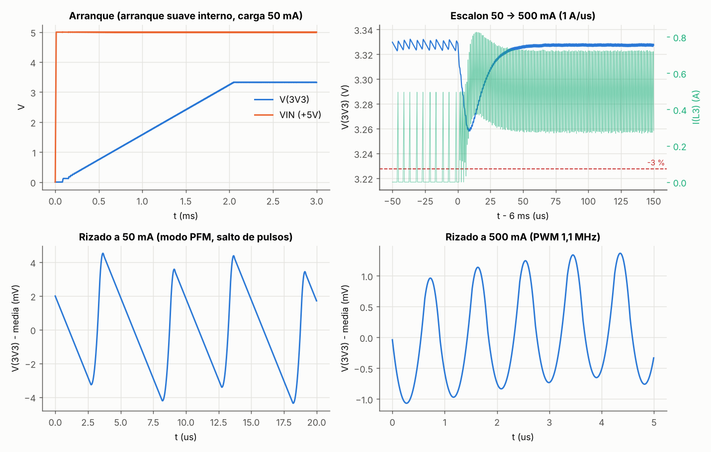
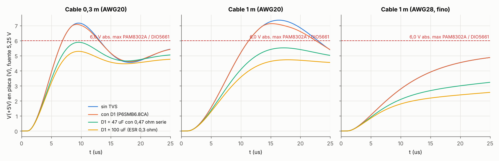
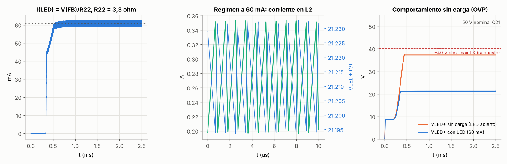
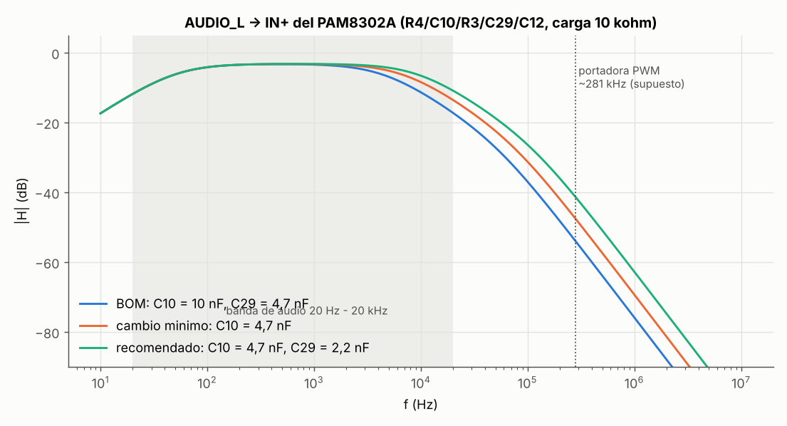
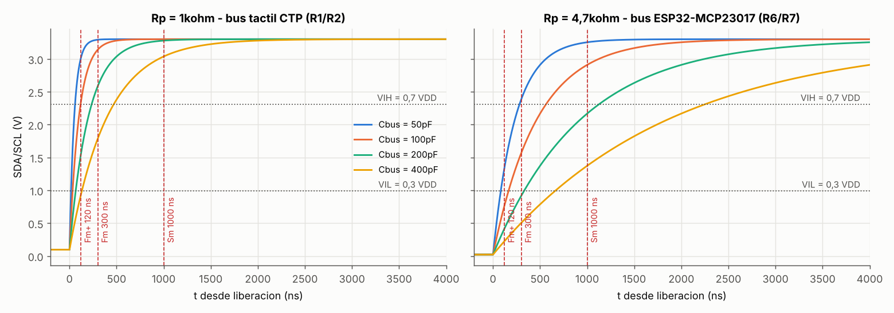

# OCX: simulaciones SPICE de la placa principal

Fecha: 2026-11-01 · Herramienta: ngspice-42 · Diseño simulado: commit `6948262` (Fab v1.0), valores tomados de los `.kicad_sch` de `hardware/` (campos Value/LCSC/MPN)

## Resumen

| # | Bloque | Veredicto | Dato clave | Margen | Cambio mínimo |
|---|---|---|---|---|---|
| 1 | Buck LMR51430 (U6), 3,3 V | **BIEN** | Escalón 50→500 mA: −69 mV (−2,1 %), +78 mV al soltar. Rizado: 9,8 mVpp (PFM) y 2,7 mVpp (PWM) | Hasta 3,0 V del ESP32-S3: 258 mV | Ninguno |
| 2 | Pico al enchufar el USB en +5V | **MAL** | 7,1–7,4 V sin TVS y 6,9–7,1 V con D1 (cable de baja resistencia, fuente a 5,25 V) | −1,1 V (por encima del límite de 6,0 V) | Añadir 100 µF en +5V con ESR entre 0,05 y 0,4 Ω (polímero o tántalo) junto a J10 → pico de 5,29 V |
| 3 | Boost DIO5661 (U8), retroiluminación | **BIEN** | I(LED) = 60,6 mA, rizado de 3,4 mApp. Sin carga, la OVP limita VLED+ a 37,3 V | C21: 12,7 V hasta 50 V. D3: 62 V hasta 100 V | Ninguno (comprobar el umbral de OVP en la hoja de datos) |
| 4 | Filtro de audio R4/C10/R3/C29/C12 | **MAL (leve)** | Paso banda de 50 Hz a **4,4 kHz**, con −14 dB a 20 kHz. Portadora PWM atenuada 51 dB | La portadora va sobrada, pero la banda de audio se queda corta | C10 de 10 nF a 4,7 nF (la misma pieza que C29, C50131) → 6,6 kHz. Mejor aún, cambiar también C29 a 2,2 nF → 9,2 kHz y −38 dB |
| 5 | Subida del I²C | **BIEN** | Con 1 k, tr = 42 ns (50 pF) y 85 ns (100 pF). Con 4,7 k, tr = 199 ns (50 pF) y 399 ns (100 pF) | 4,7 k a 400 kHz solo cumple con Cbus < 75 pF. 1 k absorbe 2,9 mA de los 3 mA permitidos | Ninguno a 400 kHz. Para Fast-mode Plus en el bus del MCP23017, bajar R6 y R7 a 2,2 k |

La única falla real es la **2**: D1 (P6SMB6.8CA) no puede proteger piezas de 6,0 V, porque su tensión de ruptura (6,45–7,14 V) ya supera ese límite. El pico se elimina amortiguando el circuito LC que forman el cable y los cerámicos. Recortarlo con el TVS no basta.

## Supuestos (decididos sin consultar)

1. **Documentos del proyecto de claude.ai** (`revision-final-esquematico.md`, `bom-lcsc.md` y `revision-01-11-teel.md`): desde esta sesión no se pueden leer. Los valores salen de los esquemáticos del repositorio, que ya tienen los campos LCSC y MPN del commit Fab v1.0. Si la BOM del proyecto difiere, basta con cambiar los netlists de `netlists/` y volver a ejecutarlos.
2. **Hojas de datos**: la red de la sesión bloquea ti.com, lcsc.com y diodes.com. Los parámetros de los CI son valores típicos de la familia y se marcan como *(sup.)*:
   - LMR51430**Y**: fsw = 1,1 MHz, VFB = 0,6 V, arranque suave ≈ 2 ms, PFM con pico mínimo de 0,5 A, límite de 4,5 A, RDS(on) de 85/50 mΩ.
   - DIO5661: fsw = 1,1 MHz y ILIM = 1,3 A (estos dos los confirman los distribuidores). VFB = 0,2 V, que encaja con los "~60 mA" del README. OVP = 37 V con 2 V de histéresis *(sup.)*.
   - PAM8302A: máximo absoluto de 6,0 V (confirmado), entrada de 10 kΩ internos y ganancia 2·150k/10k *(sup.)*.
   - P6SMB6.8CA: VBR entre 6,45 y 7,14 V (6,8 V típico) a 10 mA, Rdin ≈ 65 mΩ, Cj ≈ 2 nF.
3. **Modelos**: no hay modelos SPICE oficiales disponibles, así que todos son **genéricos**:
   - Los dos convertidores son modelos conductuales de modo corriente de pico, con interruptores ideales con RDS(on), latch SR, compensación de pendiente y amplificador de error gm con compensación interna RC. La compensación se ajustó para L y Cout de la BOM (2,2 µH y 2×22 µF, que es la combinación que TI recomienda para 3,3 V). Por tanto, las cifras transitorias son orientativas (±30 %).
   - Los cerámicos se modelan **derrateados por polarización DC**: 22 µF/0805 → 13 µF a 3,3 V; 10 µF/0805 → 7 µF a 5 V; 2,2 µF/1206 → 1,2 µF a 21 V y 0,8 µF a 37 V.
4. **Cable USB**: inductancia de bucle de 1 µH/m. Se prueban dos resistencias de bucle: 0,067 Ω/m (AWG20, el peor caso porque amortigua menos) y 0,43 Ω/m (AWG28, cable fino). A eso se suman 2×15 mΩ de conector, 10 nH de pista y una fuente rígida de 5,0 V y 5,25 V (máximo de USB 2.0) con 20 mΩ.
5. **Rail +5V en placa**: C15, C7 y C20 (10 µF cada uno), C11 (1 µF), C8 y C37 (100 nF). La ESP32-S3-DevKitC no cuelga de +5V (su pin 5V va sin conectar). El diodo VBUS interno de U2 (USBLC6-2SC6, ruptura ≥ 6 V) no se modela, lo que es conservador.
6. **Tira de LED** del panel: un diodo equivalente de ≈ 21 V a 60 mA (N = 14, RS = 2,3 Ω). EN (BACKLIGHT) está al 100 %.
7. **Audio**: la salida AUDIO_L del BT817Q es PWM con Rout = 40 Ω. La frecuencia de la portadora no aparece en ningún documento accesible: se toma ≈ 281 kHz *(sup.)*, y la gráfica muestra la atenuación a cualquier frecuencia.
8. **I²C**: la capacidad del bus no se ha medido, así que se barre entre 50 y 400 pF. Estimación: CTP ≈ 40–60 pF (BT817 + FPC + controlador táctil) y ESP32–MCP23017 ≈ 40–70 pF (pistas en una placa de 228 mm). VDD = 3,3 V, tr medido entre el 30 % y el 70 %.

---

## 1) Buck LMR51430 → 3,3 V



| Magnitud | Resultado | Criterio | Estado |
|---|---|---|---|
| Vout (R20 = 100 k, R21 = 22 k) | 3,327 V | 3,3 V ±3 % | Bien |
| Arranque, del 10 al 90 % | 1,60 ms (90 % a los 1,85 ms) | Monótono | Bien |
| Sobreimpulso de arranque | +5 mV, IL máx. de 0,50 A | < 3 %, IL ≪ Isat de L3 (XAL4020-222 ≈ 5 A) | Bien |
| Rizado a 50 mA (PFM) | 9,8 mVpp | < 33 mV (1 %) | Bien |
| Rizado a 500 mA (PWM, 1,1 MHz) | 2,7 mVpp | < 33 mV | Bien |
| Escalón 50→500 mA a 1 A/µs | −69 mV, vuelta a ±10 mV en 32 µs | > 3,0 V (ESP32-S3) / −3 % | Bien (margen de 258 mV) |
| Escalón 500→50 mA | +78 mV (paso a PFM) | < 3,6 V | Bien |

El rizado en PFM es mayor que en PWM, pero sigue siendo muy bajo. Si los ADC de los joysticks muestran ruido en reposo, existe la variante LMR51430**YF** (FPWM, misma huella), que lo elimina a cambio de peor eficiencia con carga baja.

## 2) Pico al enchufar el USB (+5V)



Pico de V(+5V) en placa con la fuente a 5,25 V (entre paréntesis, con 5,0 V):

| Cable | Sin TVS | Con D1, VBR típica 6,8 V | Con D1, VBR mínima 6,45 V | D1 + 47 µF con 0,47 Ω en serie | **D1 + 100 µF, ESR 0,3 Ω** |
|---|---|---|---|---|---|
| 0,3 m AWG20 | 7,16 V (6,82) | 7,08 V (6,82) | 6,91 V (6,73) | 5,89 V (5,61) | **5,29 V** (5,04) |
| 1 m AWG20 | 7,36 V (7,01) | 7,13 V (6,97) | 6,90 V (6,78) | 5,52 V (5,26) | **4,73 V** (4,50) |
| 0,3 m AWG28 | 5,38 V (5,12) | 5,38 V | 5,38 V | 4,76 V | 4,28 V |
| 1 m AWG28 | 5,20 V (4,95) | 5,20 V | 5,20 V | 3,76 V | 3,00 V |

Límite: 6,0 V, el máximo absoluto de PAM8302A (U4) y DIO5661 (U8).

- **Mal**: con un cable de baja resistencia (el típico de 3 A o de carga rápida), el LC formado por el cable y unos 22 µF efectivos de cerámicos está poco amortiguado (ζ ≈ 0,3). El pico alcanza 7,1–7,4 V, de 1,1 a 1,4 V por encima del límite.
- D1 solo recorta entre 0,1 y 0,25 V, porque no conduce hasta 6,45–7,14 V. **Ningún TVS sirve aquí**: uno que aguante 5,25 V permanentes (VRWM ≥ 5,0 V) rompe a ≥ 6,4 V. D1 sigue siendo útil contra ESD y sobretensiones de un cargador defectuoso, así que conviene dejarlo.
- Con un cable fino AWG28, el propio cable amortigua y el pico se queda en 5,2–5,4 V. Pero no se puede contar con el cable que use el usuario.
- **Cambio mínimo**: añadir **un** condensador de 100 µF / ≥ 10 V con **ESR entre 0,05 y 0,4 Ω** (electrolítico de polímero o tántalo de polímero en SMD) en +5V, junto a J10. El pico baja a 5,29 V en el peor caso, con 0,71 V de margen. Barrido de ESR con 100 µF, fuente a 5,25 V y cable de 0,3 m / 1 m:

  | ESR | 0,05 Ω | 0,15 Ω | 0,3 Ω | 0,6 Ω | 1 Ω | 2 Ω |
  |---|---|---|---|---|---|---|
  | Pico con 0,3 m | 5,19 V | 4,99 V | 5,29 V | 6,03 V | 6,42 V | 6,77 V |
  | Pico con 1 m | 5,13 V | 4,80 V | 4,73 V | 5,58 V | 6,13 V | 6,67 V |

  Un electrolítico de aluminio "normal" (ESR ≥ 1 Ω) **no basta**. La alternativa con dos piezas (47 µF cerámico más 0,47 Ω en serie) se queda en 5,89 V, con un margen demasiado justo.
- Efecto secundario: la capacidad en VBUS ya supera los 10 µF que la especificación USB-C permite en un sumidero, y el condensador añadido la aumenta. El pico de corriente de enchufe apenas cambia (29,5 → 31 A durante ~5 µs, limitado por el cable). Para un dispositivo que solo se alimenta de un cargador no supone un problema práctico, pero conviene mencionarlo en la memoria del TFG.

## 3) Boost DIO5661 → retroiluminación



| Magnitud | Con LED (R22 = 3,3 Ω) | Sin carga (LED abierto) | Criterio | Estado |
|---|---|---|---|---|
| I(LED) | 60,6 mA (0,2 V / 3,3 Ω), rizado de 3,4 mApp | — | 60 mA ±5 % | Bien |
| VLED+ | 21,2 V, rizado de 40 mVpp | 37,3 V, se mantiene por OVP | < 50 V (C21) | Bien |
| V(LX) máx. | 21,7 V | 37,7 V | < abs. máx. de LX (≈ 40 V *sup.*) y < 100 V (D3) | Bien, margen ~2 V |
| I(L2) en régimen | 0,20–0,35 A (CCM) | — | < 1,3 A (ILIM) | Bien |
| I(L2) máx. en el arranque | 1,0 A | 0,92 A | ≤ ILIM; Isat de FNR4030S220MT ≈ 0,9–1 A | Justo durante 0,3 ms, aceptable |
| P(R22) | 12 mW | — | < 125 mW (0805) | Bien |

- **Sin carga**, R22 lleva FB a 0 V y el CI pide el ciclo máximo. La salida sube hasta la OVP y se queda en ≈ 37 V conmutando a ráfagas. C21 (2,2 µF/50 V X7R) y D3 (SS210, 100 V) tienen margen. Este resultado depende de que la OVP real del DIO5661 sea ≈ 37–38 V, así que hay que confirmarlo en la hoja de datos: si fuera mayor de 45 V, C21 quedaría al límite.
- Al conectar VIN aparece un pico de ≈ 8,6 V en VLED+ por la resonancia L2–C21 a través de D3, antes de que el CI empiece a conmutar. No afecta a nada.
- La exactitud de los 60 mA depende de la tolerancia de VFB (normalmente ±3–5 %) más el 1 % de R22.

## 4) Filtro de audio R4/C10/R3/C29/C12



| Variante | −3 dB baja | −3 dB alta | a 10 kHz | a 20 kHz | a 281 kHz (portadora *sup.*) | a 1 MHz |
|---|---|---|---|---|---|---|
| **BOM** (C10 = 10 nF, C29 = 4,7 nF) | 50 Hz | **4,4 kHz** | −8,1 dB | −13,9 dB | −50,7 dB | −72,6 dB |
| Cambio mínimo: C10 = 4,7 nF | 50 Hz | 6,6 kHz | −5,2 dB | −10,3 dB | −44,3 dB | −66,1 dB |
| Recomendado: C10 = 4,7 nF, C29 = 2,2 nF | 50 Hz | 9,2 kHz | −3,4 dB | −7,7 dB | −38,1 dB | −59,6 dB |

Las atenuaciones son relativas a la banda de paso, que con la BOM queda en −3,3 dB por el divisor que forman la impedancia del filtro y los 10 kΩ de entrada.

- La portadora PWM se atenúa de sobra, pero el paso banda acaba en 4,4 kHz: el audio sonará apagado, como un teléfono. **Mal (leve)**: el bloque funciona, pero recorta la banda de audio sin necesidad.
- **Cambio mínimo**: C10 de 10 nF a **4,7 nF**, reutilizando la pieza de C29 (C50131), así que no entra ninguna referencia nueva en la BOM. Sube a 6,6 kHz y mantiene −44 dB en la portadora.
- **Recomendado**: además, C29 a 2,2 nF → 9,2 kHz y −38 dB. Para un altavoz pequeño y audio de 8–16 bits a ≤ 22 kHz de muestreo es un buen compromiso.
- Corte bajo: 50 Hz, por C12 con 10 kΩ más la impedancia del filtro. Es adecuado: el altavoz no reproduce por debajo de unos 200 Hz.
- Nota de nivel *(sup.)*: con la ganancia de ≈ 29,5 dB del PAM8302A, un PWM de 3,3 Vpp a fondo de escala recorta la salida. El volumen digital del EVE debe limitarse a ≈ 15–20 % del fondo de escala, o hay que añadir atenuación.

## 5) Tiempo de subida del I²C



| Rp | Cbus 50 pF | 100 pF | 200 pF | 400 pF | I de bajada (VOL = 0,4 V) |
|---|---|---|---|---|---|
| **1 k** (CTP: R1/R2) | 42 ns | 85 ns | 170 ns | 339 ns | 2,9 mA |
| **4,7 k** (ESP32–MCP23017: R6/R7) | 199 ns | 399 ns | 797 ns | 1593 ns | 0,62 mA |

Límites de tr: Standard (100 kHz) ≤ 1000 ns; Fast (400 kHz) ≤ 300 ns; Fast-mode Plus (1 MHz) ≤ 120 ns. La corriente de bajada máxima en Standard y Fast es de 3 mA.

- **1 k (bus táctil)**: **Bien** en todos los modos hasta ≈ 140 pF, incluido Fm+. El límite lo pone la corriente: 2,9 mA de los 3 mA permitidos (3 % de margen). No conviene bajar de 1 k. Si el panel CTP ya trae sus propias pull-ups (frecuente en controladores FT5x06/GT911), la corriente total pasaría de 3 mA. Hay que comprobarlo en la hoja de datos del NHD-5.0-CTP y, si las trae, subir R1/R2 a 2,2 k (tr = 93 ns con 50 pF).
- **4,7 k (bus del MCP23017)**: **Bien a 400 kHz si Cbus < 75 pF** (199 ns con 50 pF, 34 % de margen). Con 100 pF ya no cumple Fast-mode (399 ns) y solo valdría para 100 kHz. Para 400 kHz, el bus estimado de 40–70 pF tiene margen justo. Si se quiere Fast-mode Plus (el MCP23017 admite 1,7 MHz), habría que bajar R6/R7 a 2,2 k (≈ 93 ns con 50 pF).
- La bajada (tf) es de 2–11 ns en todos los casos, dominada por el transistor. Cumple holgadamente el mínimo de la especificación.

---

## Cómo reproducirlo

```bash
sudo apt-get install -y ngspice
```

```bash
pip install numpy matplotlib
```

```bash
python3 docs/simulaciones-spice/run_all.py /tmp/ocx_spice
```

`run_all.py` genera las variantes a partir de `netlists/`, lanza ngspice, rehace las 5 PNG de `graficas/` y escribe `resultados.json`. Tarda ≈ 1 min. Los datos brutos (≈ 300 MB) se quedan en el directorio de trabajo y no se versionan.

| Fichero | Contenido |
|---|---|
| `netlists/1_buck_lmr51430.cir` | Buck en modo corriente con PFM, arranque y escalón de carga |
| `netlists/2_hotplug_usb.tpl` | Fuente, cable RL, conector y cerámicos derrateados; TVS y amortiguador como parámetros |
| `netlists/3_boost_dio5661.tpl` | Boost WLED con OVP; con LED (60 mA) o sin carga |
| `netlists/4_filtro_audio.cir` | Análisis AC del filtro con la carga de entrada del PAM8302A |
| `netlists/5_i2c.tpl` | Drenador abierto con Rp y Cbus |
| `resultados.json` | Todas las métricas numéricas |

No se ha modificado nada de `hardware/`.
