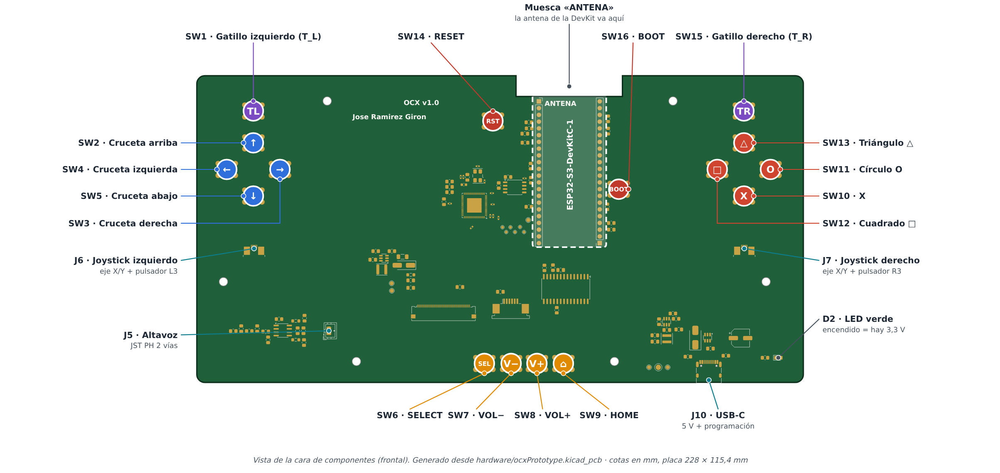
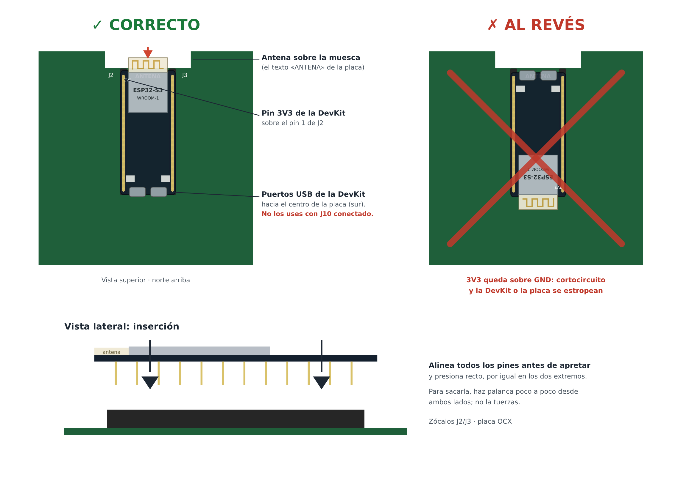
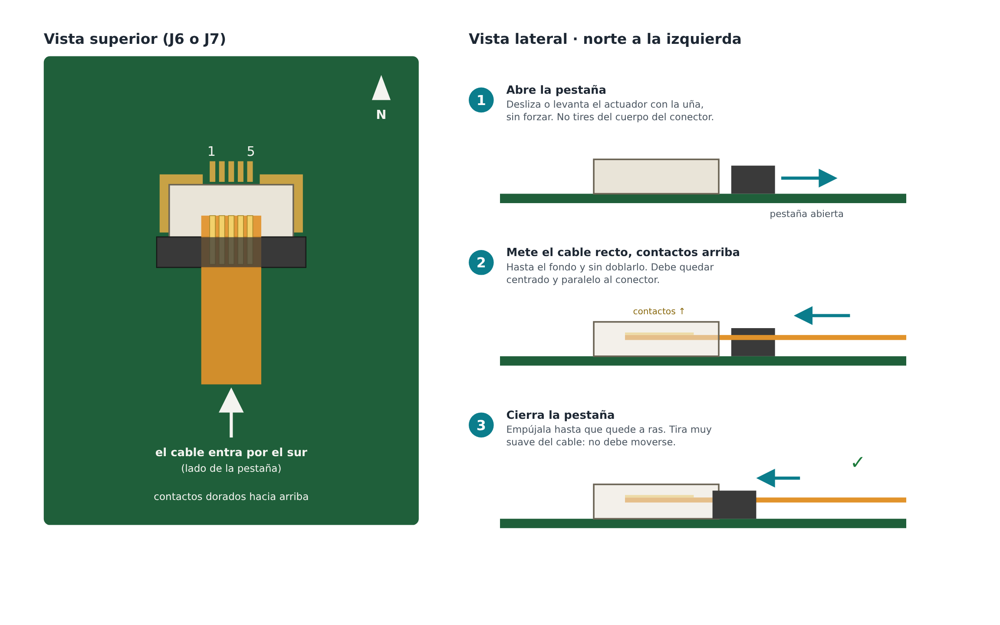
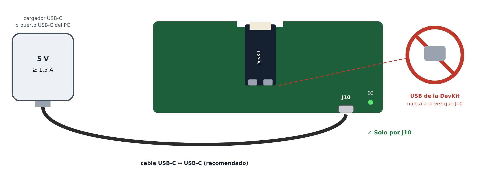
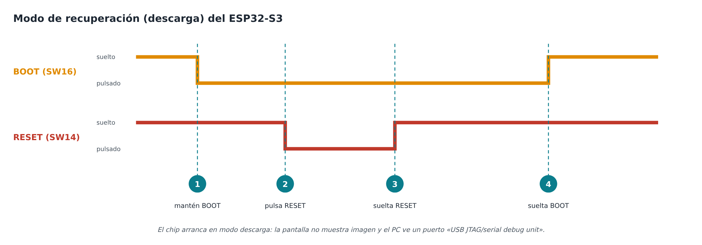
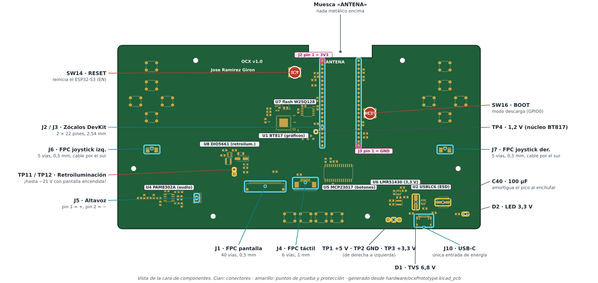

# Consola portátil OCX: manual de usuario y de mantenimiento

**Prototipo v1.0** · placa principal con la serigrafía «OCX v1.0» · revisión del manual 1.0 (noviembre de 2026)

Este manual es para quien vaya a usar la consola OCX o la reciba (por ejemplo, el tribunal del TFG o la persona que la mantenga). Explica cómo montarla, encenderla, programarla, resolver averías y cuidarla. Todo lo que dice sobre el hardware sale de los esquemas y de la placa que hay en `hardware/`.

> **Firmware.** Este documento no describe ningún firmware concreto. Lo que depende del programa que lleve cargado el ESP32-S3 (menús, ajustes, comportamiento de los botones…) aparece marcado como **[PENDIENTE DE FIRMWARE]**, con una descripción genérica. Hay que completarlo cuando el firmware esté terminado.

> **Las tres reglas que nunca debes saltarte**
>
> 1. **La consola se alimenta solo por el USB-C de la placa (J10), a 5 V.** No tiene batería.
> 2. **Nunca conectes a la vez el USB de la DevKit y el USB-C de la placa (J10).**
> 3. **La antena de la DevKit va hacia la muesca de la placa** (donde pone «ANTENA»). Si montas la DevKit al revés, se estropea.

## Índice

1. [Qué es y contenido de la caja](#que-es)
2. [Diagrama de controles](#controles)
3. [Primeros pasos](#primeros-pasos)
4. [Uso diario y ajustes](#uso-diario)
5. [Programar o actualizar el firmware](#firmware)
6. [Solución de problemas](#problemas)
7. [Mantenimiento](#mantenimiento)
8. [Especificaciones técnicas y advertencias de seguridad](#especificaciones)
9. [Anexo: señales de la placa](#anexo)

<a id="que-es"></a>

## 1. Qué es y contenido de la caja

OCX es una consola portátil que se sostiene con las dos manos, diseñada como Trabajo Fin de Grado. La placa principal reúne todos los controles y la electrónica. El «cerebro» es un módulo ESP32-S3 (una ESP32-S3-DevKitC-1) que va pinchado en dos zócalos, así que se puede sacar y cambiar sin soldar.

Componentes principales:

- **Procesador:** ESP32-S3 (dos núcleos, Wi-Fi de 2,4 GHz y Bluetooth LE), en una ESP32-S3-DevKitC-1-N16R8 con 16 MB de flash y 8 MB de PSRAM.
- **Pantalla:** 5", 800 × 480 píxeles, táctil capacitiva. La controla un chip gráfico BT817 (familia EVE4) que tiene su propia memoria flash de 16 MB para imágenes y recursos.
- **Controles:** cruceta, cuatro botones de acción (X, O, cuadrado y triángulo), dos gatillos, SELECT, HOME, VOL− y VOL+, y dos joysticks analógicos que también se pueden pulsar (L3 y R3).
- **Sonido:** mono, por un altavoz con amplificador de clase D (PAM8302A).
- **Alimentación y datos:** un único conector USB-C (J10) que sirve para alimentar y para programar.

### Contenido de la caja

| Pieza | Descripción |
|---|---|
| Placa principal OCX v1.0 | Lleva los componentes soldados, los 16 pulsadores, los conectores y los zócalos para la DevKit. |
| ESP32-S3-DevKitC-1-N16R8 | Módulo con el procesador. Se pincha en los zócalos J2 y J3. |
| Pantalla de 5" | Panel de 800 × 480 con táctil capacitivo. Lleva dos cables planos: imagen (40 vías, va a J1) y táctil (6 vías, va a J4). |
| 2 joysticks analógicos | Cada uno con su cable plano FPC de 5 vías, que va a J6 (izquierdo) o a J7 (derecho). |
| Altavoz | Con un conector JST PH de 2 vías, que va a J5. |
| Carcasa impresa | Carcasa impresa en 3D. La placa se fija a ella por sus seis taladros M3. |

**Necesitarás además:** un cargador USB-C de 5 V y al menos 1,5 A (o un puerto USB-C de ordenador) y, de preferencia, un cable USB-C a USB-C. Para programarla, un ordenador con ESP-IDF.

<a id="controles"></a>

## 2. Diagrama de controles

La imagen está generada directamente desde el diseño de la placa (`hardware/ocxPrototype.kicad_pcb`) y muestra la cara de los componentes, que es la frontal. Los nombres coinciden con los que lleva impresos la serigrafía de la placa.


*Figura 1. Botones, joysticks, conectores de usuario y LED. Cada círculo de color marca el centro de un pulsador.*

| Control | Referencia | Serigrafía | Función prevista |
|---|---|---|---|
| Gatillo izquierdo | SW1 | `BTN_T_L` | T_L **[PENDIENTE DE FIRMWARE]** |
| Cruceta arriba | SW2 | `BTN_A_UP` | Navegar hacia arriba |
| Cruceta derecha | SW3 | `BTN_A_R` | Navegar hacia la derecha |
| Cruceta izquierda | SW4 | `BTN_A_L` | Navegar hacia la izquierda |
| Cruceta abajo | SW5 | `BTN_A_DW` | Navegar hacia abajo |
| SELECT | SW6 | `BTN_SLCT` | **[PENDIENTE DE FIRMWARE]** |
| Bajar volumen | SW7 | `BTN_VOL_-` | VOL− |
| Subir volumen | SW8 | `BTN_VOL_+` | VOL+ |
| HOME | SW9 | `BTN_HOME` | Volver al menú principal **[PENDIENTE DE FIRMWARE]** |
| X | SW10 | `BTN_X` | **[PENDIENTE DE FIRMWARE]** |
| O (círculo) | SW11 | `BTN_O` | **[PENDIENTE DE FIRMWARE]** |
| Cuadrado | SW12 | `BTN_C` | **[PENDIENTE DE FIRMWARE]** |
| Triángulo | SW13 | `BTN_T` | **[PENDIENTE DE FIRMWARE]** |
| Gatillo derecho | SW15 | `BTN_T_R` | T_R **[PENDIENTE DE FIRMWARE]** |
| Joystick izquierdo | J6 | — | Ejes X e Y analógicos, y pulsador L3 |
| Joystick derecho | J7 | — | Ejes X e Y analógicos, y pulsador R3 |
| RESET | SW14 | `SW_Reset` | Reinicia el ESP32-S3 (no se pierde el firmware) |
| BOOT | SW16 | `SW_Boot` | Solo para el modo de recuperación ([apartado 5.3](#recuperacion)) |
| USB-C | J10 | — | Alimentación de 5 V, programación y consola serie |
| LED verde | D2 | — | Encendido quiere decir que hay 3,3 V en la placa |
| Altavoz | J5 | — | Salida de audio mono |

Notas:

- En la serigrafía, el cuadrado aparece como `BTN_C` y el triángulo como `BTN_T`.
- RESET y BOOT son botones de servicio. En el uso normal no hace falta tocarlos.
- La consola **no tiene interruptor**: se enciende al enchufarla y se apaga al desenchufarla.

<a id="primeros-pasos"></a>

## 3. Primeros pasos

Antes de empezar:

- Trabaja **con todo desenchufado**.
- Toca algo metálico conectado a tierra (o ponte una pulsera antiestática) antes de coger la placa o la DevKit.
- Apoya la placa sobre una superficie limpia que no conduzca electricidad.

### 3.1 Montar la ESP32-S3-DevKitC-1


*Figura 2. La antena de la DevKit (la zona del módulo con la pista en zigzag) debe quedar sobre la muesca de la placa en la que pone «ANTENA».*

1. Coloca la placa con los componentes hacia ti y con la muesca del borde superior arriba (en la serigrafía pone «ANTENA»).
2. Pon la DevKit con su módulo metálico y la antena **hacia la muesca**, y sus dos conectores USB hacia el centro de la placa.
3. Comprueba que la fila izquierda de pines entra en **J2** y la derecha en **J3**, y que no sobra ningún pin ni queda ninguno desplazado. El pin `3V3` de la DevKit debe caer sobre el pin 1 de J2, que es el más cercano a la muesca.
4. Presiona recto y con la misma fuerza en los dos extremos hasta que la DevKit quede asentada.
5. Repasa la orientación **antes de enchufar nada**. Si la antena no está sobre la muesca, la DevKit está al revés: sus pines de 3,3 V quedan sobre los de masa (GND), se produce un cortocircuito y la DevKit o la placa se estropean.

Para sacarla, haz palanca poco a poco desde los dos extremos. No la saques torciéndola hacia un lado.

> No pongas nada metálico (tornillos, cinta de aluminio, pintura metalizada) sobre la muesca de la antena: el Wi-Fi perdería alcance.

### 3.2 Conectar los joysticks


*Figura 3. El cable plano entra por el lado sur del conector, que es donde está la pestaña, con los contactos dorados hacia arriba.*

El joystick izquierdo va a **J6** y el derecho a **J7**. Los dos conectores son para cable plano FPC de 5 vías con paso de 0,5 mm.

1. Abre la pestaña (el actuador) del conector con la uña, sin forzarla. Según el modelo, la pestaña se desliza hacia fuera o se levanta.
2. Mete el cable **con los contactos hacia arriba** (tienen que verse los contactos dorados) y **entrando por el lado de la pestaña**, que es el lado sur, el que mira al borde inferior de la placa.
3. Empuja el cable recto, sin doblarlo, hasta el fondo. Tiene que quedar centrado y paralelo al conector.
4. Cierra la pestaña hasta que quede a ras.
5. Tira muy suavemente del cable: no debe moverse.

### 3.3 Pantalla y altavoz

Normalmente estas piezas ya vienen conectadas. Si no lo están:

- **Pantalla:** el cable de imagen (40 vías) va a **J1** y el del táctil (6 vías) a **J4**. Se colocan igual que los de los joysticks: abre la pestaña, mete el cable recto, cierra la pestaña. En los dos conectores el cable entra por el lado sur. La orientación de los contactos de cada cable la marca el propio conector: los contactos del cable deben quedar enfrentados a las láminas metálicas que se ven dentro. Si tienes dudas, haz una foto del montaje original antes de desconectar nada.
- **Altavoz:** enchufa su conector JST PH en **J5**. Solo entra en una posición.

### 3.4 Encendido


*Figura 4. Alimenta la consola solo por J10. El USB de la DevKit no debe usarse mientras la DevKit está montada y J10 está conectado.*

1. Conecta un cable USB-C a **J10**, en el borde inferior derecho de la placa.
2. Conecta el otro extremo a un **cargador de 5 V y al menos 1,5 A** o a un **puerto USB-C** de un ordenador.
3. El **LED verde D2**, en la esquina inferior derecha, se enciende enseguida. Eso indica que la fuente interna está dando 3,3 V.

Recomendaciones sobre la alimentación:

- **Usa un cable USB-C a USB-C.** La placa lleva las resistencias que un cargador USB-C necesita para detectarla, así que el cargador solo da tensión cuando ya está bien conectada.
- **Con un cable USB-A → USB-C**, la tensión llega de golpe al enchufar. El condensador C40 (100 µF), junto con el diodo de protección D1, limita el pico que se produce. Funciona, pero es mejor un cable C-C.
- **Los puertos USB-A de ordenador** suelen dar solo de 0,5 A a 0,9 A. Con la pantalla al máximo, el Wi-Fi activo y sonido, la consola puede llegar a pedir alrededor de 1 A y reiniciarse. En ese caso usa un cargador de 1,5 A o más, o un puerto USB-C.
- Una batería externa USB (powerbank) de 5 V y al menos 1,5 A también sirve.
- **No conectes nunca el USB de la DevKit mientras J10 está conectado.** La DevKit tiene su propia fuente: las dos se pelearían por la línea de 3,3 V, y además los dos USB comparten las mismas líneas de datos del ESP32-S3. Lo más seguro es esto: con la DevKit montada, usa solo J10. Si necesitas el USB de la propia DevKit, sácala antes de la placa.

### 3.5 Qué se ve en el primer arranque

| Momento | Qué pasa | Si no pasa |
|---|---|---|
| Al enchufar | Se enciende el LED verde D2. | Consulta «No enciende» en el [apartado 6](#problemas). |
| De 1 a 3 s después | **[PENDIENTE DE FIRMWARE]** Lo normal es que la pantalla se ilumine y muestre una pantalla de arranque o un logotipo. | Consulta «LED encendido y pantalla negra». |
| Después | **[PENDIENTE DE FIRMWARE]** Aparece el menú principal o la aplicación que haya por defecto. | — |
| En el PC (si está conectado) | Aparece un dispositivo USB llamado *USB JTAG/serial debug unit* (VID `303A`, PID `1001`). Es el puerto de programación y de consola. | Consulta «El PC no la detecta». |

> Si la DevKit está **sin programar** o lleva un firmware que no es el de OCX, lo normal es que la pantalla se quede negra: el ESP32-S3 no ha puesto en marcha el chip gráfico. El LED D2 se enciende igualmente. Carga el firmware siguiendo el [apartado 5](#firmware).

<a id="uso-diario"></a>

## 4. Uso diario y ajustes

### 4.1 Encender y apagar

- **Encender:** conecta el cable USB-C a J10.
- **Apagar:** **[PENDIENTE DE FIRMWARE]** Si el firmware guarda datos (partidas, ajustes), sal antes al menú principal o usa la opción de apagado que tenga, si existe, para que no se corte la corriente en mitad de una escritura en la flash. Después desconecta el cable.
- **Reiniciar:** pulsa RESET (SW14). No borra el firmware.

### 4.2 Navegación y botones

- **Cruceta y joystick izquierdo:** mover la selección por los menús. **[PENDIENTE DE FIRMWARE]**
- **Botones de acción (X, O, cuadrado, triángulo):** confirmar, volver y acciones de cada aplicación. **[PENDIENTE DE FIRMWARE]** El firmware debe documentar qué botón confirma y cuál cancela.
- **HOME:** volver al menú principal desde cualquier aplicación. **[PENDIENTE DE FIRMWARE]**
- **SELECT:** abrir opciones o el menú contextual. **[PENDIENTE DE FIRMWARE]**
- **Gatillos T_L y T_R, L3 y R3:** dependen de cada aplicación. **[PENDIENTE DE FIRMWARE]**
- **Pantalla táctil:** tocar para seleccionar. **[PENDIENTE DE FIRMWARE]**

### 4.3 Ajustes

| Ajuste | Hardware disponible | Cómo se ajusta |
|---|---|---|
| Volumen | Amplificador mono PAM8302A. El firmware genera el sonido a través del BT817 y activa o desactiva el amplificador. | Con VOL+ y VOL−. **[PENDIENTE DE FIRMWARE]** Indicador en pantalla, silencio y volumen máximo. |
| Brillo | Retroiluminación regulable (la controla el BT817). | **[PENDIENTE DE FIRMWARE]** Por ejemplo, desde un menú de ajustes o con HOME + VOL±. Con menos brillo, la consola consume menos. |
| Wi-Fi / Bluetooth | ESP32-S3 (Wi-Fi de 2,4 GHz y Bluetooth LE). | **[PENDIENTE DE FIRMWARE]** Búsqueda de redes, contraseña, activar y desactivar. |
| Calibración de los joysticks | Ejes analógicos leídos por el ADC del ESP32-S3. | **[PENDIENTE DE FIRMWARE]** Lo normal es dejar el joystick en reposo para fijar el centro y luego girarlo en círculos para fijar los extremos. |
| Calibración del táctil | Táctil capacitivo leído por el BT817. | **[PENDIENTE DE FIRMWARE]** Lo normal es tocar unos puntos que aparecen en pantalla. |
| Información del sistema | — | **[PENDIENTE DE FIRMWARE]** Versión del firmware, memoria libre y dirección MAC. |

### 4.4 Buenas costumbres

- Usa la consola con la carcasa puesta: protege la placa de golpes, del sudor y de las descargas de electricidad estática.
- No tires del cable USB-C de lado: así se estropea el conector J10. Sujeta el conector, no el cable.
- Si notas que algo se calienta mucho o huele a quemado, **desenchúfala inmediatamente**.

<a id="firmware"></a>

## 5. Programar o actualizar el firmware

La consola se programa **por el mismo USB-C J10** que la alimenta. J10 va directamente al USB nativo del ESP32-S3, que funciona como *USB-Serial/JTAG*: sirve para grabar el firmware, para ver los mensajes de la consola serie y para depurar con JTAG. No hace falta ningún adaptador ni el USB de la DevKit.

### 5.1 Qué necesitas

- Un ordenador con **ESP-IDF** instalado, versión 5.x **[PENDIENTE DE FIRMWARE: versión exacta]**. También el código del firmware de OCX **[PENDIENTE DE FIRMWARE: repositorio o carpeta]**.
- Un cable USB-C que transmita datos. Algunos cables solo sirven para cargar.
- La consola conectada **solo por J10**.

Nombre del puerto según el sistema:

| Sistema | Puerto habitual | Notas |
|---|---|---|
| Linux | `/dev/ttyACM0` | Tu usuario debe pertenecer al grupo `dialout` (o `uucp`, según la distribución). |
| Windows 10/11 | `COMx` | El controlador se instala solo. El número aparece en el Administrador de dispositivos. |
| macOS | `/dev/cu.usbmodemXXXX` | No necesita controlador. |

### 5.2 Grabar el firmware

Desde la carpeta del proyecto del firmware:

```bash
idf.py set-target esp32s3
```

```bash
idf.py build
```

```bash
idf.py -p /dev/ttyACM0 flash monitor
```

Cambia `/dev/ttyACM0` por el puerto que tengas. `flash` graba el firmware y `monitor` muestra después los mensajes de la consola serie. Para salir del monitor, pulsa `Ctrl` + `]`.

Normalmente `idf.py` reinicia el chip y lo pone en modo de descarga sin que tengas que hacer nada. Si no lo consigue (aparece `Failed to connect` o `No serial data received`), usa el modo de recuperación.

Ajustes del proyecto que dependen de este hardware **[PENDIENTE DE FIRMWARE]**: flash de 16 MB, PSRAM *octal* de 8 MB y consola por *USB Serial/JTAG*. Si no se configuran así, la consola puede no arrancar o no mostrar mensajes por J10.

<a id="recuperacion"></a>

### 5.3 Modo de recuperación

Usa este modo si la consola no arranca, si el PC ha dejado de verla o si un firmware defectuoso impide grabar uno nuevo. Fuerza al ESP32-S3 a arrancar desde su memoria interna de fábrica (ROM), que no se puede borrar. Desde ahí siempre se puede volver a grabar.


*Figura 5. La secuencia para entrar en el modo de descarga.*

1. Con la consola conectada por J10, **mantén pulsado BOOT** (SW16, a la derecha de la DevKit).
2. Sin soltar BOOT, **pulsa y suelta RESET** (SW14, a la izquierda de la DevKit).
3. **Suelta BOOT.**
4. El chip queda en modo de descarga: la pantalla no muestra imagen y el PC ve el dispositivo *USB JTAG/serial debug unit*. El número de puerto puede cambiar.
5. Graba el firmware con `idf.py -p <puerto> flash`.
6. Cuando termine, pulsa **RESET** para arrancar el firmware nuevo, si no ha arrancado solo.

Los botones BOOT y RST de la propia DevKit hacen lo mismo que SW16 y SW14.

### 5.4 Borrar la flash por completo

Si quieres borrar también los ajustes guardados y empezar de cero:

```bash
idf.py -p /dev/ttyACM0 erase-flash
```

Después vuelve a grabar el firmware. **[PENDIENTE DE FIRMWARE]** Indicar si hay datos del usuario (partidas, ajustes) que se pierden, y si los recursos gráficos de la flash del BT817 hay que grabarlos por separado.

<a id="problemas"></a>

## 6. Solución de problemas

Antes de nada: **desconecta y vuelve a conectar** la consola, y prueba con otro cable y otro cargador. Muchas averías aparentes son un cable que solo carga o un cargador flojo.

En las mediciones con polímetro se usa **TP2 (GND)** como referencia. Los puntos de prueba están en la [figura 6](#mantenimiento).

| Síntoma | Causa probable | Qué hacer |
|---|---|---|
| **No enciende** (LED D2 apagado) | Cargador o cable defectuosos; conector J10 sucio o dañado. | Prueba con otro cargador (de 5 V y al menos 1,5 A) y otro cable. Limpia J10 con aire. Mide TP1: debe dar unos 5 V. |
| | Hay 5 V en TP1, pero TP3 no da 3,3 V. | Desenchufa. Comprueba que la DevKit **no está al revés** ([3.1](#primeros-pasos)) y que no hay restos metálicos ni puentes de estaño en la placa. Si sigue igual, revisa el regulador U6. |
| | No hay 5 V en TP1 aunque el cargador funciona. | El diodo de protección D1 puede haberse quedado en cortocircuito por una sobretensión, o J10 tiene una soldadura rota. Hay que revisarlos y sustituirlos. |
| **LED encendido, pantalla negra** | La DevKit está sin firmware, el firmware no arranca o está en modo de recuperación. | Conecta el PC y abre el monitor (`idf.py -p <puerto> monitor`) para ver los mensajes. Pulsa RESET. Si hace falta, vuelve a grabar el firmware ([5](#firmware)). |
| | El cable de imagen no está bien asentado en J1. | Desenchufa, abre la pestaña de J1, recoloca el cable recto y hasta el fondo, y vuelve a cerrar. |
| | La retroiluminación está apagada. | **[PENDIENTE DE FIRMWARE]** Revisa el ajuste de brillo. Con la pantalla encendida, entre TP11 y TP12 tiene que haber tensión (hasta unos 21 V). Mide con cuidado. |
| **Pantalla iluminada pero sin imagen, con imagen temblando o con rayas** | J1 mal asentado o cable de imagen dañado. | Recoloca J1. Mira si el cable tiene marcas de pliegue. |
| | Parámetros de la pantalla mal configurados en el firmware. | **[PENDIENTE DE FIRMWARE]** Comprueba que el firmware usa la configuración de un panel de 800 × 480. |
| **Colores cambiados** (rojo y azul intercambiados, tonos raros, degradados con escalones) | El firmware configura mal el orden de los colores o la polaridad del reloj de píxel del BT817. | **[PENDIENTE DE FIRMWARE]** Revisa la configuración de la pantalla en el firmware (orden RGB y polaridad del reloj). |
| | Una línea de color del cable J1 no hace contacto (falta un bit de color). | Recoloca el cable de J1. Si el defecto cambia al presionar suavemente el conector, es un problema de contacto o de soldadura. |
| **El táctil no responde o detecta el toque en otro sitio** | El cable del táctil (J4) está suelto o al revés. | Recoloca el cable de J4. |
| | Falta calibrar. | **[PENDIENTE DE FIRMWARE]** Haz la calibración del táctil. Quita los protectores de pantalla gruesos. |
| **Un botón no responde** | El firmware no lo usa en esa pantalla. | Pruébalo en otra aplicación o menú. **[PENDIENTE DE FIRMWARE]** Usa la pantalla de prueba de entradas, si la hay. |
| | La carcasa no llega a pulsar el botón o lo deja pulsado. | Con la consola abierta, pulsa el botón directamente sobre la placa. Ajusta la pieza de la carcasa. |
| | El pulsador está sucio o tiene una soldadura rota. | Con la consola **desenchufada**, mide continuidad entre las dos patas del pulsador: al pulsarlo debe marcar 0 Ω. Si no, sustituye el pulsador (6 × 6 mm, de agujero pasante). |
| **No responde ningún botón** (los joysticks sí) | El firmware no ha arrancado el expansor de botones U5 (MCP23017), o hay un fallo en el bus I²C. | **[PENDIENTE DE FIRMWARE]** Mira en el monitor serie si hay errores de I²C. Revisa las soldaduras de U5. |
| **El joystick se desvía solo** (*drift*) | Hay que recalibrar el centro o ampliar la zona muerta. | **[PENDIENTE DE FIRMWARE]** Haz la calibración de los joysticks. |
| | Cable FPC mal asentado, doblado o sucio. | Recoloca el cable en J6/J7 y limpia los contactos ([7.4](#cuidado-fpc)). |
| | El joystick está gastado. | Sustitúyelo ([7.1](#cambiar-joystick)). |
| **El joystick no responde o un eje se queda en un extremo** | El cable está al revés (contactos hacia abajo) o torcido. | Recoloca el cable: contactos hacia arriba, entrando por el lado de la pestaña. |
| **L3 o R3 no responde** | Cable mal asentado o pulsador del joystick dañado. | Recoloca el cable. Prueba el joystick en el otro conector. Si el fallo se va con él, el defecto está en el joystick. |
| **No hay sonido** | Volumen a cero, silencio activado o amplificador apagado por el firmware. | Sube con VOL+. **[PENDIENTE DE FIRMWARE]** Revisa el ajuste de sonido. Sin firmware el amplificador está apagado: es lo normal. |
| | Altavoz desconectado o con un cable roto. | Comprueba que está enchufado en J5. Con la consola desenchufada, mide el altavoz: debe marcar unos pocos ohmios. |
| **Sonido distorsionado, o la consola se reinicia al subir el volumen** | El cargador no da corriente suficiente. | Usa un cargador de al menos 1,5 A y un cable corto. Evita los puertos USB-A del PC. |
| | Altavoz de menos de 4 Ω. | Sustitúyelo por uno de 4 Ω u 8 Ω. |
| **Se reinicia sola** (sobre todo con mucho brillo o con el Wi-Fi activo) | La fuente no aguanta los picos de alrededor de 1 A. | Usa un cargador de al menos 1,5 A o un puerto USB-C. Cambia el cable por uno corto y de calidad. Baja el brillo. |
| | Fallo del firmware. | Mira en el monitor serie el motivo del reinicio (*reset reason*, *panic*). |
| **El PC no la detecta** | El cable solo carga y no transmite datos. | Usa un cable que transmita datos. |
| | El firmware ha desactivado o cambiado el USB nativo. | Entra en el modo de recuperación ([5.3](#recuperacion)). En ese modo el dispositivo siempre aparece. |
| | Falta de permisos en Linux. | Añade tu usuario al grupo `dialout` y vuelve a iniciar sesión. |
| | Estás usando el USB de la DevKit. | Usa solo J10 ([3.4](#primeros-pasos)). |
| **`idf.py flash` falla** (`Failed to connect`, `No serial data received`) | El chip no ha entrado en modo de descarga, u otro programa tiene el puerto abierto. | Cierra otros monitores serie. Entra en el modo de recuperación y vuelve a intentarlo. |
| **El Wi-Fi tiene poco alcance** | La antena no está sobre la muesca, o hay metal encima. | Comprueba la orientación de la DevKit. Quita el metal de la zona de la muesca. |
| **Una zona de la placa se calienta** | Que estén templados el regulador U6, el driver de retroiluminación U8 o el amplificador U4 es normal. Si alguno quema al tacto, hay un fallo. | **Desenchufa.** Revisa la orientación de la DevKit y busca cortocircuitos. |

<a id="mantenimiento"></a>

## 7. Mantenimiento


*Figura 6. Conectores (en cian), puntos de prueba y protecciones (en amarillo), y circuitos integrados principales.*

Reglas para cualquier intervención:

- **Desenchufa siempre J10** antes de abrir la consola, conectar o desconectar cables FPC, o sacar la DevKit.
- Protégete de la electricidad estática: usa una pulsera antiestática o toca metal conectado a tierra.
- Trabaja sobre una superficie limpia y bien iluminada. Haz fotos de cada paso antes de desmontar.
- Abrir la carcasa: **[PENDIENTE: depende del diseño final de la carcasa]**. La placa se sujeta por seis taladros M3.

<a id="cambiar-joystick"></a>

### 7.1 Cambiar un joystick

1. Desenchufa la consola y abre la carcasa.
2. Abre la pestaña de J6 (izquierdo) o J7 (derecho) y saca el cable recto, sin tirar de lado.
3. Quita el joystick viejo de su alojamiento en la carcasa.
4. Comprueba que el repuesto tiene **la misma asignación de pines** antes de conectarlo:

   | Pin del FPC | Señal |
   |---|---|
   | 1 | Eje X |
   | 2 | GND (masa) |
   | 3 | Pulsador (L3 o R3) |
   | 4 | Eje Y |
   | 5 | +3,3 V |

   > Hay joysticks de repuesto con FPC de 5 vías que tienen otra asignación de pines. Si no coincide, puedes poner en cortocircuito los 3,3 V o leer los ejes cambiados. Comprueba la hoja de datos del repuesto o mídelo antes de conectarlo.

5. Coloca el joystick nuevo y conecta el cable como en el [apartado 3.2](#primeros-pasos).
6. Cierra, enciende y **recalibra** los joysticks. **[PENDIENTE DE FIRMWARE]**

### 7.2 Cambiar la pantalla

Repuesto: **Newhaven NHD-5.0-800480AF-ASXP-CTP** (5", 800 × 480, RGB, con táctil capacitivo). Otras pantallas de 5" pueden tener otra asignación de pines en el cable de 40 vías o necesitar otra tensión de retroiluminación. No las montes sin revisar antes el esquema.

1. Desenchufa la consola, abre la carcasa y **haz una foto** de cómo están los dos cables y hacia qué lado miran sus contactos.
2. Abre la pestaña de **J1** (imagen, 40 vías) y saca el cable recto.
3. Abre la pestaña de **J4** (táctil, 6 vías) y saca el cable.
4. Suelta la pantalla de la carcasa. **[PENDIENTE: depende de la carcasa (adhesivo, marco, clips)]** No hagas palanca sobre el cristal.
5. Coloca la pantalla nueva y conecta primero el cable de J1 y después el de J4, con la misma orientación que en la foto. Los dos cables entran por el lado sur del conector.
6. Antes de cerrar la carcasa, enciende y comprueba la imagen y el táctil. Si hace falta, recalibra el táctil. **[PENDIENTE DE FIRMWARE]**

> El cable de 40 vías es muy fino (0,5 mm entre contactos). No lo dobles en ángulo vivo y no lo fuerces si no entra recto.

### 7.3 Cambiar la DevKit

- Repuesto: **ESP32-S3-DevKitC-1-N16R8**. Otras versiones (N8, N8R2, N32R8…) tienen otra cantidad de flash o de PSRAM y pueden no funcionar con el firmware. **[PENDIENTE DE FIRMWARE]**
- Sácala y pon la nueva como se explica en el [apartado 3.1](#primeros-pasos): **la antena hacia la muesca**.
- La DevKit nueva viene sin el firmware de OCX. Grábalo por J10 ([apartado 5](#firmware)).

### 7.4 Limpieza

- **Carcasa y pantalla:** usa un paño de microfibra seco o un poco humedecido con agua o alcohol isopropílico. **No eches ningún líquido directamente** sobre la consola.
- **Botones:** si se quedan duros o «pegados», sopla con aire comprimido alrededor con la consola desenchufada.
- **Conector USB-C J10:** quita la pelusa con aire o con un palillo de plástico o de madera. Nunca con objetos metálicos.
- **Placa:** si se ensucia, usa alcohol isopropílico de al menos el 90 % y un cepillo suave. Deja que se seque del todo antes de enchufar.

<a id="cuidado-fpc"></a>

### 7.5 Cuidado de los conectores FPC (J1, J4, J6, J7)

- **Nunca** conectes ni desconectes un cable FPC con la consola enchufada.
- Abre la pestaña antes de meter o sacar el cable. Sacarlo con la pestaña cerrada daña los contactos.
- Mete el cable recto y centrado. Si entra torcido, puede unir dos contactos vecinos.
- No dobles los cables en ángulo vivo ni los pliegues sobre sí mismos. Deja curvas suaves.
- Estos conectores aguantan pocas decenas de conexiones y desconexiones. No los manipules si no hace falta.
- Si los contactos del cable están sucios u oxidados, límpialos con un bastoncillo con alcohol isopropílico y deja que se sequen.
- Si se rompe una pestaña, el cable ya no queda sujeto. Hay que sustituir el conector, y eso requiere soldar componentes de montaje superficial muy finos.

### 7.6 Almacenamiento

- Guárdala en un lugar seco y sin polvo, lejos del sol directo y de fuentes de calor. La carcasa impresa en 3D puede deformarse con el calor (por ejemplo, dentro de un coche al sol).
- No dejes peso encima de la pantalla.

<a id="especificaciones"></a>

## 8. Especificaciones técnicas y advertencias de seguridad

### 8.1 Especificaciones

| Apartado | Valor |
|---|---|
| Procesador | ESP32-S3 (Xtensa LX7 de dos núcleos), en una ESP32-S3-DevKitC-1-N16R8 sobre zócalos de 2 × 22 pines |
| Memoria | 16 MB de flash y 8 MB de PSRAM octal (DevKit); 16 MB de flash W25Q128JV para el chip gráfico |
| Conectividad inalámbrica | Wi-Fi de 2,4 GHz (802.11 b/g/n) y Bluetooth LE (del ESP32-S3) |
| Pantalla | 5", 800 × 480, RGB de 24 bits, táctil capacitivo (Newhaven NHD-5.0-800480AF-ASXP-CTP) |
| Controlador gráfico | BT817Q (EVE4), con cristal de 12 MHz y conexión SPI cuádruple al ESP32-S3 |
| Retroiluminación | Driver DIO5661 de corriente constante, unos 60 mA a unos 21 V |
| Controles | 14 pulsadores (cruceta, X, O, cuadrado, triángulo, T_L, T_R, SELECT, HOME, VOL−, VOL+) leídos por un MCP23017 por I²C; 2 joysticks analógicos con pulsador (L3 y R3); RESET y BOOT |
| Audio | Mono. Amplificador de clase D PAM8302A alimentado a 5 V, salida en puente a un altavoz por un JST PH de 2 vías (J5). Admite altavoces de 4 Ω u 8 Ω. |
| Alimentación | Solo por USB-C (J10), 5 V. Sin batería. Regulador conmutado LMR51430 de 5 V a 3,3 V. |
| Consumo | Unos 0,6 A típicos; hasta unos 1 A en picos (pantalla al 100 %, Wi-Fi y audio) |
| Fuente recomendada | Cargador USB-C de 5 V y al menos 1,5 A, o puerto USB-C. Cable C-C recomendado. |
| Protecciones | Diodo TVS de 6,8 V en VBUS (D1), protección ESD en las líneas USB (USBLC6-2), condensador de 100 µF a la entrada (C40) |
| USB de datos | USB 2.0 Full Speed nativo del ESP32-S3 (USB-Serial/JTAG) por J10 |
| Indicador | LED verde D2: hay 3,3 V |
| Placa | 228 × 115,4 mm, 1,6 mm de grosor, 4 capas, acabado ENIG, seis taladros M3 |
| Diseño | KiCad 10.0. Hardware con licencia CERN-OHL-S-2.0; documentación con licencia CC BY-SA 4.0 |

### 8.2 Advertencias de seguridad

- **Alimentación:** usa solo fuentes USB de 5 V. No conectes la placa a otras tensiones ni a fuentes de laboratorio por encima de 5 V. **No conectes a la vez el USB de la DevKit y J10.**
- **Montaje de la DevKit:** la antena va siempre hacia la muesca de la placa en la que pone «ANTENA». Si se monta al revés, se produce un cortocircuito en la alimentación y la DevKit o la placa se estropean.
- **Electricidad estática:** la placa lleva componentes sensibles. Manipúlala sin ella y sujétala por los bordes.
- **Retroiluminación:** con la pantalla encendida hay **hasta unos 21 V** en TP11 y TP12 y en los pines 1 y 2 de J1. No es una tensión peligrosa para las personas, pero un cortocircuito accidental con la punta del polímetro puede dañar la pantalla o su driver.
- **Uso con la carcasa:** no uses la placa sin carcasa encima de superficies metálicas o húmedas.
- **Calor:** si algún componente quema al tacto o huele a quemado, desenchufa la consola y no la vuelvas a usar hasta revisarla.
- **Oído:** no uses volúmenes altos durante mucho rato y baja el volumen antes de acercar la consola a la oreja.
- **Salud:** como cualquier pantalla con imágenes en movimiento, puede provocar crisis en personas con epilepsia fotosensible. Descansa unos 10 a 15 minutos por cada hora de juego.
- **Niños:** contiene piezas pequeñas y cables finos. No es apta para menores de 3 años y se recomienda usarla bajo la supervisión de un adulto.
- **Prototipo:** OCX es un prototipo académico. No ha pasado ensayos de certificación (marcado CE, compatibilidad electromagnética, seguridad eléctrica). Úsala como equipo de desarrollo y evaluación.
- **Reciclaje:** al final de su vida útil, no la tires a la basura normal. Llévala a un punto limpio como residuo de aparato eléctrico y electrónico (RAEE).

<a id="anexo"></a>

## 9. Anexo: señales de la placa

Esta tabla sirve como referencia para el mantenimiento y para quien escriba el firmware. Está sacada de las redes del `.kicad_pcb`. Los GPIO son los del ESP32-S3, según la asignación de pines de la DevKitC-1.

### 9.1 Puntos de prueba

| Punto | Señal | Valor esperado (con la consola encendida) |
|---|---|---|
| TP1 | +5 V (VBUS de J10) | 4,75 V a 5,25 V |
| TP2 | GND | Referencia |
| TP3 | +3,3 V | 3,3 V (±3 %) |
| TP4 | 1,2 V del núcleo del BT817 | Unos 1,2 V, si el BT817 está activo |
| TP5 a TP10 | Bus SPI cuádruple del BT817 (IO2, MISO, SCK, MOSI, IO3, CS_N) | Señales digitales de 3,3 V |
| TP11 / TP12 | Retroiluminación VLED+ / VLED− | Hasta unos 21 V entre ellos, con la pantalla encendida |

### 9.2 Conexiones del ESP32-S3

| Función | GPIO | Notas |
|---|---|---|
| USB D− / D+ (J10) | 19 / 20 | USB-Serial/JTAG nativo |
| BT817: SCK, MOSI, MISO, CS_N | 12, 11, 13, 10 | SPI |
| BT817: IO2, IO3 | 14, 9 | Líneas extra del SPI cuádruple |
| BT817: INT_N, PD_N | 5, 4 | Interrupción y apagado (PD_N con resistencia de pull-up) |
| I²C de los botones: SCL, SDA | 15, 16 | Resistencias de pull-up de 4,7 kΩ. MCP23017 en la dirección 0x20. |
| MCP23017: INTA, RESET | 17, 18 | RESET con resistencia de pull-up de 10 kΩ |
| Joystick izquierdo: X, Y, pulsador | 6, 7, 8 | Ejes por el ADC1. Pulsador con resistencia de pull-up de 10 kΩ (activo a nivel bajo). |
| Joystick derecho: X, Y, pulsador | 2, 1, 47 | Ejes por el ADC1. Pulsador con resistencia de pull-up de 10 kΩ (activo a nivel bajo). |
| Activación del amplificador (PAM8302A SD) | 21 | Resistencia de pull-down de 47 kΩ: el amplificador está apagado hasta que el firmware pone el pin a nivel alto |
| BOOT (SW16) / RESET (SW14) | 0 / EN | — |

### 9.3 Botones en el MCP23017

Los pulsadores conectan el pin a GND al pulsar. En la placa no hay resistencias de pull-up externas para estos botones, así que el firmware debe activar las internas del MCP23017 (registro GPPU). **[PENDIENTE DE FIRMWARE]**

| Puerto A | Botón | Puerto B | Botón |
|---|---|---|---|
| GPA0 | SW1 T_L | GPB0 | SW8 VOL+ |
| GPA1 | SW2 arriba | GPB1 | SW9 HOME |
| GPA2 | SW3 derecha | GPB2 | SW10 X |
| GPA3 | SW4 izquierda | GPB3 | SW11 O |
| GPA4 | SW5 abajo | GPB4 | SW12 cuadrado |
| GPA5 | SW6 SELECT | GPB5 | SW13 triángulo |
| GPA6 | SW7 VOL− | GPB6 | SW15 T_R |
| GPA7 | Libre | GPB7 | Libre |

### 9.4 Cómo se generan las imágenes

Las figuras 1 y 6 se generan con `manual/herramientas/gen_placa.py` a partir de `hardware/ocxPrototype.kicad_pcb`. Si cambias la placa, vuelve a generarlas y crea el PDF con `manual/herramientas/generar-pdf.sh` (ver `manual/LEEME.md`).
